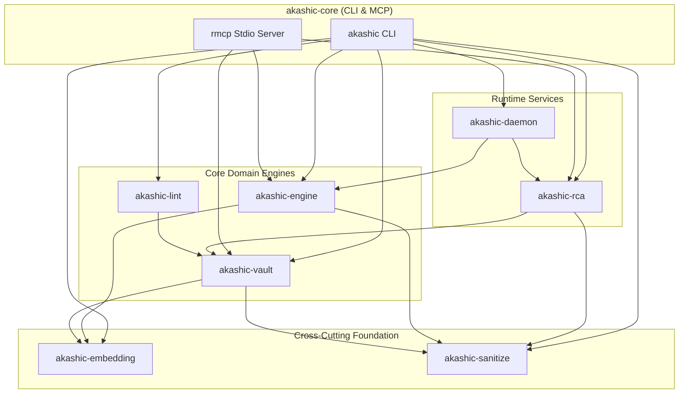

# Akashic

Akashic unifies a Markdown Vault engine, an incremental AST Code Graph engine, and a Root Cause Analysis (RCA) system. It supports autonomous coding agents and OEM Android engineering workflows through a single Rust CLI and Model Context Protocol (MCP) server.

## Architecture

The Cargo workspace organizes eight crates into a strict Directed Acyclic Graph (DAG) with zero circular dependencies:



### Workspace Crates

| Crate | Responsibility |
| --- | --- |
| `akashic-sanitize` | Runs `CodeProfile` and `LogProfile` for Data Sanitization and Format-Preserving Semantic Pseudonymization. |
| `akashic-embedding` | Defines the `EmbeddingProvider` trait, HTTP client, and local embedding sidecar supervisor. |
| `akashic-vault` | Parses Google Open Knowledge Format (OKF) v0.2 Vault Nodes, runs four query modes, plans mutations, and manages the Vault Index. |
| `akashic-lint` | Checks Vault schema rules `L001` through `L012` and custom TOML frontmatter constraints. |
| `akashic-engine` | Extracts Tree-sitter Code Symbols and Code Edges, performs Non-Destructive Ingestion, detects Graph Communities and God Nodes, and computes Blast Radius. |
| `akashic-rca` | Executes the 6-stage Local-Host Conductor pipeline, Symbolication, Soak Storm Deduplication Gate, and Crystallization into Resolution Nodes. |
| `akashic-daemon` | Monitors the Gerrit Event Stream, batches Gerrit Event Triggers with adaptive debounce, and runs Clone-to-Onboard Discovery. |
| `akashic-core` | Exposes the unified `akashic` CLI binary and the `rmcp` MCP server over standard I/O. |

### Physical Storage Isolation

Markdown files in Git remain the canonical source of truth for Vault content. Akashic isolates physical SQLite persistence across three domain databases in `.akashic/`:

| Database Path | Owner | Purpose |
| --- | --- | --- |
| `.akashic/vault_index.db` | `akashic-vault` | Disposable Vault Index caching Vault Node frontmatter, forward Relations, FTS5 search tables, and vector embeddings. |
| `.akashic/code_graph.db` | `akashic-engine` | Disposable Code Graph storing Code Symbols, Code Edges with Edge Provenance (`EXTRACTED`, `INFERRED`, `AMBIGUOUS`), Graph Communities, FTS5 indexes, and `sqlite-vec` vectors. |
| `.akashic/rca_state.db` | `akashic-rca`, `akashic-daemon` | Durable checkpoint store holding Local-Host Conductor workflow states, Crash Signatures, Symbol Store LRU Cache metadata, and Gerrit stream watermarks. |

## Build and Test

Build the workspace with the Rust 2024 toolchain:

```bash
# Build release binary
cargo build --release

# Run all workspace unit and integration tests
cargo test --workspace
```

The compiled binary resides at `target/release/akashic`.

## Configuration

Akashic loads `config/akashic.toml` by default. Pass `--config <path>` to any CLI command to override the configuration path.

```toml
[vault]
path = "vault"
db_path = ".akashic/vault_index.db"
okf_version = "0.2"

[lint]
enabled_rules = ["L001", "L002", "L003", "L004", "L005", "L006", "L007", "L008", "L009", "L010", "L011"]
strict_forward_only = true

[embedding]
enabled = false
endpoint = "http://127.0.0.1:8080/v1/embeddings"
model = "nomic-embed-text-v1.5"
dimensions = 768

[engine]
db_path = ".akashic/code_graph.db"
languages = ["java", "kotlin", "cpp", "rust", "python", "go", "typescript"]
inferred_similarity_threshold = 0.82
god_node_degree_threshold = 25
rrf_k = 60

[rca]
db_path = ".akashic/rca_state.db"
symbol_store_path = ".akashic/symbols"
symbol_cache_max_mb = 2048
agent_cli = "gemini"
soak_dedup_enabled = true

[daemon]
db_path = ".akashic/rca_state.db"
gerrit_host = "gerrit.mot.com"
gerrit_port = 29418
debounce_quiet_secs = 30
debounce_max_cap_secs = 300
loop_drop_prefix = "akashic/"
auto_discovery_enabled = true

[sanitize]
code_profile_enabled = true
log_profile_enabled = true
preserve_column_alignment = true
```

## CLI Usage

### Vault Operations (`akashic vault`)

Each Vault Node uses OKF v0.2 YAML frontmatter and asserts directed forward Relations (`supersedes`, `resolves`, `depends_on`, `supported_by`, `caused_by`, `relates_to`, `contradicts`). The engine derives inverse paths automatically and abstains on any Unresolved Conflict.

```bash
# Initialize an empty Vault directory
akashic vault init --path vault

# Query Current Guidance, lineage, impact, or historical state
akashic vault query --mode current --node-id INC-123 --scope env=production

# Inspect Vault Node frontmatter and Relations
akashic vault inspect INC-123

# Generate a dry-run migration Plan before mutating files
akashic vault plan --path vault --out plan.json

# Apply a reviewed Plan with pre-apply lint and SHA-256 pre-image checks
akashic vault apply --path vault --plan plan.json

# Rebuild the local Vault Index from Markdown files
akashic vault reindex --path vault
```

### Vault Linting (`akashic lint`)

Check Vault schema invariants (`L001`–`L011`) and custom TOML field rules (`L012`):

```bash
# Run standard lint checks
akashic lint --vault vault

# Enforce strict forward-only relation rules with JSON output
akashic lint --vault vault --strict --json
```

### Code Graph Operations (`akashic graph`)

`akashic-engine` parses Java, Kotlin, C++, Rust, Python, Go, and TypeScript with Tree-sitter without calling an LLM.

```bash
# Index a repository at a specific Git commit
akashic graph index --repo-path . --repo-name akashic --commit HEAD

# Perform incremental Graph Reconciliation between two Git revisions
akashic graph reconcile --repo-path . --repo-name akashic --old-rev HEAD~1 --new-rev HEAD

# Search Code Symbols via FTS5 and vector similarity
akashic graph query "ConductorPipeline" --repo-name akashic --limit 20

# Look up a Code Symbol across indexed repositories
akashic graph symbol "VaultGraph"

# Find the shortest directed path between two Code Symbols
akashic graph path "source_symbol" "target_symbol" --repo-name akashic --max-hops 10

# Inspect Code Symbol details and signature
akashic graph explain "symbol_id" --repo-name akashic

# Detect Graph Communities and God Nodes
akashic graph communities --repo-name akashic
akashic graph god-nodes --repo-name akashic --top-n 10
akashic graph surprising --repo-name akashic --top-n 10

# Compute transitive Blast Radius for a Code Symbol
akashic graph blast-radius "symbol_id" --repo-name akashic --max-depth 3

# Generate architectural report or community wiki
akashic graph report --repo-name akashic --format md
akashic graph wiki --repo-name akashic --out-dir wiki

# Scan workspace for Git repositories and Android package mappings
akashic graph discover --path .
```

### Root Cause Analysis (`akashic rca`)

The Local-Host Conductor executes a 6-stage Investigation pipeline with durable SQLite checkpointing, Symbolication, Crash Signature deduplication, two-stage Hypothesis testing, and Crystallization.

```bash
# Execute the end-to-end 6-stage RCA pipeline
akashic rca run --app-id com.motorola.camera3 --log-file crash.log --jira-key IKSW-100

# Start, resume, or check an Investigation
akashic rca start IKSW-100
akashic rca resume <investigation_id>
akashic rca status <investigation_id>

# Symbolicate a raw crash log
akashic rca symbolicate --app-id com.motorola.camera3 --log-file crash.log

# Crystallize verified findings into a Resolution Node
akashic rca crystallize --run-id <run_id> --summary "Root cause and fix details"

# Supersede an obsolete Resolution Node
akashic rca supersede --old-id RES-100 --new-id RES-101 --reason "Updated permanent fix"

# List open Investigations
akashic rca triage
```

### Background Daemon & Embedding Sidecar

```bash
# Control the Gerrit Event Stream daemon and workspace discovery
akashic daemon start
akashic daemon status
akashic daemon catchup --stream gerrit
akashic daemon discover --workspace .
akashic daemon stop

# Control the local embedding sidecar
akashic embedding start-sidecar
akashic embedding status
akashic embedding benchmark --count 32
akashic embedding stop
```

### Data Sanitization (`akashic sanitize`)

```bash
# Test syntax-preserving CodeProfile redaction
akashic sanitize test-code -i sample.rs

# Test Format-Preserving Semantic Pseudonymization with LogProfile
akashic sanitize test-log -i logcat.txt
```

## Model Context Protocol (MCP) Server

Start the unified stdio MCP server for agent integration:

```bash
akashic mcp --vault vault --workspace .
```

| Domain | MCP Tool | Description |
| --- | --- | --- |
| Vault | `vault_query` | Query Vault Nodes by mode (`current`, `lineage`, `impact`, `historical`) and optional Scope filter. |
| Vault | `vault_inspect` | Inspect a Vault Node by ID to view metadata, frontmatter, and Relations. |
| Vault | `vault_lint` | Check a Vault directory for OKF v0.2 rule compliance. |
| Vault | `vault_read` | Read the Markdown content of a Vault Node by ID. |
| Vault | `vault_write_canonical` | Write or update a canonical OKF v0.2 Vault Node. |
| Code Graph | `graph_query` | Search Code Symbols in the Code Graph using full-text search. |
| Code Graph | `graph_get_node` | Get Code Symbol details, signature, and file location by ID. |
| Code Graph | `graph_get_neighbors` | Get incoming callers and outgoing Code Edges for a Code Symbol. |
| Code Graph | `graph_get_community` | Get Graph Community clusters or filter by community ID. |
| Code Graph | `graph_god_nodes` | Identify God Nodes with high degree centrality. |
| Code Graph | `graph_stats` | Get summary counts of Code Symbols, Code Edges, and Graph Communities. |
| Code Graph | `graph_shortest_path` | Find the shortest dependency path between two Code Symbols. |
| Code Graph | `graph_blast_radius` | Compute transitive upstream callers, downstream dependencies, and impacted Graph Communities. |
| RCA | `rca_status` | Check the status of an ongoing or completed RCA Investigation. |
| RCA | `rca_trigger` | Run the end-to-end Local-Host Conductor Investigation pipeline. |
| RCA | `rca_symbolicate` | Parse and symbolicate a stack trace against Code Graph or mapping files. |
| RCA | `rca_crystallize` | Crystallize RCA Investigation findings into a canonical Resolution Node. |

## Documentation

- [Domain Ubiquitous Language (`CONTEXT.md`)](CONTEXT.md)
- [Unified Architecture Specification (`docs/specs/0001-unified-akashic-architecture.md`)](docs/specs/0001-unified-akashic-architecture.md)
- [Architecture Decision Records (`docs/adr/`)](docs/adr/)
- [Stage 4 Read-Only Agent Policy (`config/policies/stage4-readonly.toml`)](config/policies/stage4-readonly.toml)

## License

MIT License. See [`LICENSE`](LICENSE) for details.
