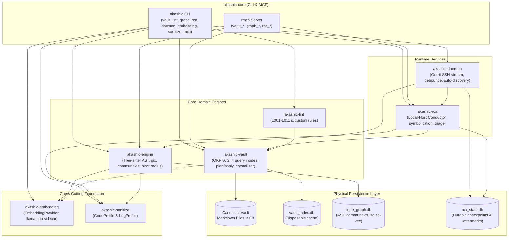

# Unified Akashic Knowledge Graph, Code Graph, and RCA Architecture

## Problem Statement

Autonomous coding agents and OEM Android software engineers operating across large-scale mobile codebases face severe fragmentation when synthesizing knowledge, analyzing code structures, and diagnosing production regressions:

1. **Repository & Tooling Fragmentation**: Architectural capabilities are divided across three independent repositories (`akashic-records` for Markdown knowledge graph mechanics, `alexandria` for incremental AST code graphs and daemon streaming, and `knowledge-base` for root cause analysis workflows), alongside an external Python `graphify` dependency. Users and autonomous agents must navigate mismatched CLI commands (`akashic-records`, `alexandria-cli`, `rca-cli`, `graphify`), discordant configuration files, and separate Model Context Protocol (MCP) servers.
2. **Duplicated & Inconsistent Sanitization**: Data scrubbing routines for proprietary tokens, credentials, and sensitive telemetry identifiers are duplicated across repositories or applied inconsistently, risking credential leakage in embedding vector stores or breaking logcat alignment through naive regex replacements.
3. **Slow, Expensive LLM-Driven Code Indexing**: Reference tools such as Python `graphify` rely on interactive LLM prompting to parse code repositories and infer entity links during indexing. Across Android OEM repositories containing millions of lines of code, LLM-driven indexing is cost-prohibitive, non-deterministic, and exceedingly slow.
4. **Database & Concurrency Sprawl**: Ad-hoc SQLite schemas and concurrent writes across background Git indexing, continuous Gerrit event streaming, and multi-stage RCA state transitions trigger database lock contention, while coupling ephemeral AST projections with durable RCA checkpoints prevents safe cache wiping and reconstruction.
5. **Schema Drift & Fragile Graph Mutations**: Lacking a single source of truth for the Google Open Knowledge Format (OKF) v0.2 schema and forward-only relation rules, autonomous agents risk introducing circular supersession dependencies or modifying target nodes retroactively, polluting Git commit histories.

## Solution

The **Akashic** platform consolidates Markdown knowledge graphs, incremental multi-language AST code graphs, and automated root cause analysis into a single, cohesive Cargo workspace. The architecture enforces clean domain boundaries through an 8-crate Directed Acyclic Graph (DAG), isolates persistence across three domain-specific SQLite databases alongside Git-tracked Markdown documents, guarantees fast and deterministic code indexing via multi-language Tree-sitter parsers and local embedding sidecars (zero LLM calls during indexing), protects secrets with profile-driven sanitization, and provides a unified CLI and `rmcp`-based MCP server.



## User Stories

1. As an Autonomous AI Coding Agent, I want to execute a `Current Guidance` query over a specified system Scope, so that I receive only active, authoritative architectural decisions without reading obsolete or superseded nodes.
2. As an Autonomous AI Coding Agent, I want to query the historical lineage of a Vault Node, so that I understand why prior decisions were superseded and what empirical evidence led to those changes.
3. As an Autonomous AI Coding Agent, I want to run an impact query on a target Vault Node, so that I discover all dependent decisions, active incidents, and open runbooks prior to altering an architectural contract.
4. As an Autonomous AI Coding Agent, I want to perform a point-in-time historical query on the Vault, so that I can inspect the exact state of knowledge that existed when a legacy incident occurred.
5. As an Autonomous AI Coding Agent, I want the engine to strictly abstain from choosing a winner when encountering supersession cycles or competing active nodes, so that I am never guided by arbitrary heuristics or silent fallbacks.
6. As a Knowledge Base Maintainer, I want to run `akashic vault plan` to generate a dry-run diff of proposed frontmatter metadata and relation normalizations, so that I can review and verify mutations before touching Markdown files on disk.
7. As a Knowledge Base Maintainer, I want to apply a verified mutation plan using `akashic vault apply`, so that frontmatter updates are atomically written to Git Markdown files and validated against lint rules.
8. As a Knowledge Base Maintainer, I want to safely wipe and rebuild `vault_index.db` from Markdown files in Git, so that corrupted local cache states can be reconstructed deterministically.
9. As a Knowledge Base Maintainer, I want arbitrary project-specific YAML frontmatter fields preserved losslessly during deserialization and serialization, so that custom tool integrations never drop metadata.
10. As a Knowledge Base Maintainer, I want `akashic lint` to enforce rules `L001` through `L011`, so that broken links, non-deterministic IDs, untyped relations, and invalid schema invariants are caught immediately.
11. As a Knowledge Base Maintainer, I want to declare custom frontmatter field validation rules in `akashic.toml`, so that project-specific domain constraints are checked alongside standard OKF rules.
12. As an OEM Android Engineer, I want the Code Graph engine to extract Git trees and file blobs directly from the bare Git object database using `gix`, so that background indexing never alters my working tree, checks out branches, or creates git index lock collisions.
13. As an OEM Android Engineer, I want Tree-sitter to parse source files across Java, Kotlin, C++, Rust, Python, Go, and TypeScript, so that structural code declarations and calls are extracted into a polyglot Code Graph without running external language servers.
14. As an OEM Android Engineer, I want code edges classified into explicit Edge Provenance (`EXTRACTED`, `INFERRED`, `AMBIGUOUS`), so that I can distinguish deterministic AST call invocations from embedding similarity links.
15. As an OEM Android Engineer, I want incoming Git diffs evaluated through a Structural Significance Filter, so that trivial method-body edits and formatting changes do not trigger expensive community recalculations or spurious Vault alerts.
16. As an Autonomous AI Coding Agent, I want to query Graph Communities detected via Louvain/Leiden modularity clustering, so that I can reason about high-level module boundaries and subsystem cohesion.
17. As an Autonomous AI Coding Agent, I want to identify God Nodes in the Code Graph, so that I recognize central architectural hubs bridging disparate communities before attempting refactoring.
18. As an Autonomous AI Coding Agent, I want to execute token-budgeted BFS/DFS graph traversals and shortest-path queries over code symbols, so that I can trace call sequences within LLM prompt limits.
19. As an OEM Android Engineer, I want to compute the Blast Radius of a patchset or commit, so that I know the transitive set of upstream callers, downstream dependencies, and graph communities impacted prior to submission.
20. As a Knowledge Base Maintainer, I want to export Code Graph projections into `GRAPH_REPORT.md` or markdown wikis, so that human engineers can navigate repository architecture offline.
21. As a Platform Infrastructure Operator, I want `akashic-embedding` to manage the process lifecycle of a local `llama.cpp` sidecar, so that embedding generation runs locally without relying on paid cloud APIs.
22. As an Autonomous AI Coding Agent, I want hybrid retrieval combining `sqlite-vec` dense embeddings and FTS5 BM25 lexical search with Reciprocal Rank Fusion, so that code and documentation searches return relevant results even when terminology differs.
23. As a Security and Compliance Officer, I want `CodeProfile` to scrub API secrets, private keys, and proprietary tokens before code chunks are vectorized or indexed, so that secrets are never stored in embeddings while valid AST syntax is preserved.
24. As a Security and Compliance Officer, I want `LogProfile` to apply Format-Preserving Semantic Pseudonymization to diagnostic logs, so that PII is masked without breaking column alignments or regex parsers.
25. As a Triage & RCA Engineer, I want the Local-Host Conductor state machine to checkpoint investigation progress into `rca_state.db`, so that long-running investigations survive crashes or reboots without starting over.
26. As a Triage & RCA Engineer, I want stack traces symbolicated locally via `addr2line` and R8 `retrace` backed by an NVMe Symbol Store LRU cache, so that symbolication executes in milliseconds without network hops.
27. As a Triage & RCA Engineer, I want incoming soak crash storms filtered through the Soak Storm Deduplication Gate using `CrashSignature` hashing, so that hundreds of identical crash tickets attach as evidence to a single active Incident rather than triggering redundant reasoning runs.
28. As an Autonomous AI Coding Agent, I want to execute a two-stage hypothesis generation and adversarial falsification loop, so that candidate root causes contradicting empirical evidence are discarded before conclusions are drawn.
29. As a Triage & RCA Engineer, I want verified fixes crystallized into authoritative `Resolution` Vault Nodes documenting remediation types and negative knowledge, so that engineering teams learn from failed fix attempts.
30. As a Platform Infrastructure Operator, I want `akashic-daemon` to monitor the Gerrit SSH event stream with adaptive sliding debounce and watermark catch-up, so that bursts of merged changes are batched efficiently without losing events after network disconnects.
31. As an OEM Android Engineer, I want cloned Android repositories automatically registered via Clone-to-Onboard Discovery, so that package identifiers across Gradle and Manifest files are mapped into the Package-to-Repository Index with zero manual configuration.
32. As an Autonomous AI Coding Agent, I want a unified `akashic` CLI binary and `rmcp` MCP server with `<domain>_<action>` tools, so that I can access Vault, Code Graph, and RCA capabilities through a single consistent interface that degrades gracefully when optional sidecars are offline.

## Implementation Decisions

### Eight-Crate Layered Workspace Topology

The Cargo workspace located in `crates/` enforces a strict Directed Acyclic Graph (DAG) with zero circular dependencies:

```
akashic-sanitize (no internal dependencies)
akashic-embedding (no internal dependencies)
akashic-vault (depends on: akashic-sanitize, akashic-embedding)
akashic-lint (depends on: akashic-vault)
akashic-engine (depends on: akashic-sanitize, akashic-embedding)
akashic-rca (depends on: akashic-vault, akashic-sanitize)
akashic-daemon (depends on: akashic-engine, akashic-rca)
akashic-core (depends on: all crates; exposes CLI and MCP server)
```

Each crate possesses an isolated, single responsibility:
- `akashic-sanitize`: Syntax-preserving and format-preserving sanitization logic.
- `akashic-embedding`: `EmbeddingProvider` trait, HTTP client, and process sidecar supervisor.
- `akashic-vault`: Markdown parser, OKF v0.2 data model, 4 query engines, plan/apply mechanics, crystallizer primitives, and `vault_index.db`.
- `akashic-lint`: Independent lint engine executing rules `L001`–`L011` and custom TOML validations.
- `akashic-engine`: High-performance Tree-sitter Code Graph, `gix` bare Git ingestion, community detection, God Node detection, blast radius, and `code_graph.db`.
- `akashic-rca`: Host-native Local-Host Conductor state machine, crash symbolication, `CrashSignature` deduplication, and crystallization.
- `akashic-daemon`: Background Gerrit event monitor, sliding debounce, watermark replay, and Clone-to-Onboard repository registry.
- `akashic-core`: CLI command dispatcher and `rmcp`-based MCP server.

### Physical SQLite Persistence Isolation

To eliminate WAL write-lock contention between high-churn AST indexing and durable RCA checkpointing, persistence is physically divided into three separate SQLite database files under the workspace `.akashic/` directory (configurable in `akashic.toml`):

1. `.akashic/code_graph.db` (owned exclusively by `akashic-engine`):
   - Stores `CodeSymbol`, `CodeEdge`, `GraphCommunity` tables, FTS5 BM25 text indices, and `sqlite-vec` vector tables.
   - Fully disposable and reconstructible from bare Git history.
2. `.akashic/rca_state.db` (owned by `akashic-rca` and `akashic-daemon`):
   - Stores durable Conductor investigation task states, `CrashSignature` deduplication records, Gerrit high-watermark timestamps, and Symbol Store LRU cache metadata.
   - High-durability checkpoint store; never automatically wiped.
3. `.akashic/vault_index.db` (owned by `akashic-vault`):
   - Caches parsed Vault Node frontmatter, forward Relations, FTS5 indexes, and node embeddings.
   - Fully disposable and reconstructible from Markdown files in Git.
4. **Cross-Domain Join Contract**: Cross-domain queries between Code Symbols and Vault Nodes are joined in Rust memory at the `akashic-core` or MCP boundary, or executed via read-only SQLite `ATTACH DATABASE` statements without opening concurrent write handles.

### OKF v0.2 Schema & Custom Field Extensibility

The canonical format for all knowledge nodes is whole-note Markdown documents with YAML frontmatter adhering to the Google OKF v0.2 specification:

```rust
pub struct VaultNodeFrontmatter {
    pub id: String,
    pub title: String,
    pub r#type: NodeType, // Incident, Resolution, Architecture, Decision, Runbook, Evidence
    pub status: NodeStatus, // active, superseded, resolved, draft
    pub valid_from: Option<String>,
    pub scope: BTreeMap<String, String>,
    pub relations: Vec<Relation>,
    #[serde(default)]
    pub external_refs: Vec<String>,
    #[serde(flatten)]
    pub custom: BTreeMap<String, serde_yaml::Value>,
}

pub struct Relation {
    pub r#type: RelationType, // supersedes, resolves, depends_on, supported_by, caused_by, relates_to, contradicts
    pub target: String,
    #[serde(default)]
    pub evidence: Option<String>,
    #[serde(default)]
    pub scope: Option<BTreeMap<String, String>>,
}
```

- **Forward-Only Invariant**: All relation edges are asserted strictly in forward direction by the active/successor node. Inverse backlinks (`superseded_by`, `resolved_by`) are strictly forbidden in frontmatter to prevent mutating existing Git commits.
- **Resolution Nodes & Negative Knowledge**: `type: Resolution` specifies a `remediation_type` (`workaround`, `hotfix`, `permanent_fix`, `revert`) and includes negative knowledge attributes (`invalidated_hypotheses: Vec<String>`, `failed_attempts: Vec<String>`).
- **Lossless Custom Attributes**: The `#[serde(flatten)]` map preserves all non-standard YAML keys during serialization.
- **Custom Lint Rules**: `akashic.toml` defines optional schema constraints under `[lint.custom_fields]` (e.g. required regex patterns or allowed enum values).

### Deterministic AST & Embedding-Backed Code Graph Engine (`akashic-engine`)

`akashic-engine` supersedes Python `graphify` and `alexandria-core` with a unified Rust implementation:

- **Zero-LLM Indexing Invariant**: Codebase indexing never invokes an LLM. AST extraction is purely deterministic using Tree-sitter parsers for Java, Kotlin, C++, Rust, Python, Go, and TypeScript.
- **Edge Provenance**:
  ```rust
  pub enum EdgeProvenance {
      Extracted, // Deterministically parsed AST call, inheritance, or type reference
      Inferred,  // High-confidence cosine similarity via embedding sidecar (>= threshold)
      Ambiguous, // Multiple resolution candidates requiring runtime disambiguation
  }
  ```
- **Graph Community Detection**: Implements Louvain and Leiden modularity optimization over the in-memory graph, assigning each Code Symbol to a `GraphCommunity` with an intra-cluster cohesion score ($0.0 \le C \le 1.0$).
- **God Nodes & Bridges**: Calculates node degree centrality and betweenness centrality. Symbols exceeding configurable degree thresholds are flagged as `God Nodes`, and edges spanning disparate communities are cataloged as `surprising_connections`.
- **Non-Destructive Ingestion (`gix`)**: Reads file blobs directly from bare Git commits into memory buffers. Developer working trees and branch pointers remain untouched.
- **Structural Significance Filter**: Inspects diffs at commit boundaries. If a commit modifies only private method bodies, comments, or formatting, Code Graph reconciliation performs a lightweight hash update and suppresses Vault drift alerts.
- **Documentation Projections**: Exports full graph visualizations and module summaries to `GRAPH_REPORT.md` or a structured markdown wiki.

### Embedding Provider & Sidecar Lifecycle (`akashic-embedding`)

- **Contract**:
  ```rust
  #[async_trait]
  pub trait EmbeddingProvider: Send + Sync {
      async fn embed_batch(&self, texts: &[String]) -> Result<Vec<Vec<f32>>, EmbeddingError>;
      fn dimension(&self) -> usize;
      fn is_available(&self) -> bool;
  }
  ```
- **Sidecar Lifecycle**: Manages an external local process (e.g. `llama.cpp` server) or connects to an existing local OpenAI-compatible endpoint (e.g. `http://127.0.0.1:8080/v1/embeddings`). Spawns, monitors health via HTTP probes, and terminates child sidecar processes cleanly on shutdown.
- **Hybrid Retrieval**: Combines `sqlite-vec` cosine similarity rankings with SQLite FTS5 BM25 text scores using Reciprocal Rank Fusion ($k = 60$).
- **Graceful Offline Degradation**: If the embedding sidecar is unreachable or disabled, `akashic-engine` and `akashic-vault` continue operating without error, falling back to AST relationships and BM25 lexical search.

### Profile-Driven Sanitization (`akashic-sanitize`)

All data filtering is consolidated into two deterministic sanitization profiles:

- **`CodeProfile`**: Applied prior to code chunk vectorization or graph storage. Scans for API secrets, AWS/GCP keys, passwords, and private tokens using regex token classification and AST identifier analysis. Matches are replaced with syntax-preserving dummy tokens (e.g. `"SECRET_API_KEY"` becomes `"SAN_STR_TOKEN_A8F1"`, preserving string quotes and variable syntax).
- **`LogProfile`**: Applied to raw logcat dumps, tombstones, and Bug2Go diagnostic files. Executes Format-Preserving Semantic Pseudonymization (e.g. replacing phone numbers with `<PHONE:US_VALID_10DIGIT>` and MAC addresses with `<MAC:ADDR_VALID>`) using a deterministic per-session cryptographic salt. Fixed-width column alignments, line lengths, and cross-event entity identities are preserved.

### Host-Native RCA State Machine, Symbolication & Crystallization (`akashic-rca`)

- **Local-Host Conductor**: Executes a 6-stage investigation state machine checkpointed durably into `rca_state.db`:
  1. *Trigger Ingestion*: Ingests Bug2Go / MotoJira trigger payloads.
  2. *Sanitization & Slicing*: Cleans logs via `akashic-sanitize` (`LogProfile`) and extracts relevant crash windows.
  3. *Symbolication*: Resolves native addresses via `addr2line` and Java/Kotlin obfuscated frames via R8 `retrace`, utilizing an NVMe-backed Symbol Store LRU cache (`.akashic/symbols/`).
  4. *Soak Storm Deduplication Gate*: Computes `CrashSignature = sha256(app_id + exception_signal + top_3_symbolicated_app_frames)`. If an active incident matches the signature, appends trigger as `Evidence` and terminates pipeline early.
  5. *Two-Stage Reasoning*: Invokes the local headless agent CLI (`gemini`) in a sandboxed, read-only session to generate candidate hypotheses and subsequently falsify them against empirical evidence.
  6. *Crystallization*: Formats verified findings into canonical OKF v0.2 `Incident`, `Evidence`, and `Resolution` Markdown nodes, validates them through `akashic-lint`, and writes them to the target Vault partition (`akashic/<app_id>/`).

### Background Runtime, Debounce & Auto-Discovery (`akashic-daemon`)

- **Gerrit Event Stream Watcher**: Maintains an open SSH connection to the Gerrit event stream (`gerrit stream-events`).
- **Loop Drop Filter**: Automatically drops events originating from the `akashic/*` knowledge repository to prevent self-triggering synchronization loops.
- **Adaptive Sliding-Window Debounce**: Batches incoming merge and patchset events with a `30s` quiet window and a `300s` hard maximum cap, aggregating multi-commit merges into a single Code Graph indexing pass.
- **Persistent Watermark Catch-Up**: Stores the last processed event timestamp in `.akashic/rca_state.db`. Upon reconnect or service startup, queries missed events (`gerrit query after:<watermark>`) to replay changes before resuming the real-time stream.
- **Clone-to-Onboard Discovery**: Watches the workspace root with `notify`. Upon detecting a newly cloned Git repository, a 5-pass parser inspects `settings.gradle`, module `build.gradle`, and `AndroidManifest.xml` files to resolve `applicationId`, `namespace`, and package names, populating the `Package-to-Repository Index` in `code_graph.db` and provisioning the corresponding Vault partition.

### Clean-Slate CLI & Unified MCP Contract (`akashic-core`)

The platform ships a single `akashic` binary with domain-aligned subcommands and a unified `rmcp` MCP server:

```
akashic
├── vault
│   ├── query [--mode current|lineage|impact|historical] [--scope key=val]
│   ├── plan [--out plan.json]
│   ├── apply [--plan plan.json]
│   └── reindex
├── lint [--path <vault_path>]
├── graph
│   ├── index [--commit <sha>]
│   ├── symbol <query>
│   ├── blast-radius <symbol_or_diff>
│   ├── communities
│   ├── god-nodes
│   └── report [--format md|wiki]
├── rca
│   ├── start <trigger_id>
│   ├── resume <investigation_id>
│   ├── status <investigation_id>
│   └── triage
├── daemon
│   ├── run
│   └── status
├── embedding
│   ├── status
│   └── start-sidecar
├── sanitize
│   ├── test-code
│   └── test-log
└── mcp
    └── (runs standard I/O rmcp JSON-RPC server)
```

The unified MCP server exposes tools namespaced as `<domain>_<action>`:
- `vault_query`, `vault_plan`, `vault_apply`, `vault_lint`
- `graph_query_symbol`, `graph_blast_radius`, `graph_get_communities`, `graph_get_god_nodes`
- `rca_start_investigation`, `rca_get_status`, `rca_crystallize`

## Testing Decisions

### Definition of a Good Test

A good test validates observable external behavior, command exit codes, stdout/stderr outputs, JSON-RPC responses over the MCP boundary, and persistent database/file states at public contracts. Tests must never assert against internal private fields, intermediary AST walker pointers, or transient memory allocations.

### Primary Testing Seam (Unified `akashic-core` CLI & MCP Boundary Seam)

The primary testing seam executes integration test suites against the compiled `akashic` CLI binary and `akashic mcp` JSON-RPC interface using a deterministic test workspace fixture:

- **Fixture Structure**: A temporary directory initialized with `akashic.toml`, a multi-language Git repository containing Java, C++, Kotlin, and Rust source files with planted secrets and PII, a canonical OKF v0.2 Markdown Vault directory, mock Gerrit event payloads, and a local mock HTTP embedding server.
- **End-to-End Scenarios Tested**:
  1. *Vault Query & Mutation*: Executing `akashic vault query --mode current`, planning a frontmatter update, and applying it via `akashic vault apply`, asserting that Git Markdown files are updated losslessly and validated against `akashic lint`.
  2. *Code Graph Indexing & Ingestion*: Running `akashic graph index` over the fixture repository using `gix`, asserting zero modifications to the developer working tree, validating deterministic `EXTRACTED` call edges in `code_graph.db`, and verifying Louvain community partition outputs.
  3. *Blast Radius Calculation*: Invoking `akashic graph blast-radius` with a simulated diff touching a God Node, asserting the correct upstream and downstream caller set.
  4. *Sanitization & Embeddings*: Ingesting code chunks containing planted API keys, asserting that `CodeProfile` sanitizes secrets before `sqlite-vec` insertion, and testing RRF hybrid search recall.
  5. *RCA Pipeline & Deduplication*: Starting an RCA investigation with a mock tombstone fixture, verifying `CrashSignature` generation, confirming that identical subsequent crashes trigger the Soak Storm Deduplication Gate, and crystallizing verified findings into the test Vault.
  6. *Physical Isolation Verification*: Deleting `code_graph.db` and `vault_index.db`, verifying that `rca_state.db` checkpoints remain intact, and confirming that both deleted databases reconstruct cleanly from Git.

### Modules Tested & Prior Art

The unified integration test suite consolidates prior art from existing test harnesses across all three pre-merge projects:
- `akashic-records`: Test suites covering OKF v0.2 parsing, 4 query engines, forward-only supersession traversal, cycle abstention, and `L001`–`L011` lint validation rules.
- `alexandria`: Test suites covering Tree-sitter AST extraction, bare `gix` commit ingestion, sliding-window debounce, watermark replay, and `event_to_projection_seam` end-to-end pipelines.
- `knowledge-base`: Test suites covering Local-Host Conductor state transitions, `addr2line` / R8 symbolication, and Bug2Go diagnostic slicing.

## Out of Scope

- **Backwards Compatibility with Legacy Commands**: Maintaining backwards compatibility with legacy CLI binary invocations (`alexandria-cli`, `akashic-records`, `rca-cli`, `graphify`) or legacy MCP tool names is out of scope for this architecture (tracked as a separate downstream migration task for external agent skills and configurations).
- **LLM-Driven Code Indexing**: Using LLM calls to parse, summarize, or extract relationships during codebase or Vault indexing is strictly prohibited.
- **External Orchestration Infrastructure**: Deploying or supporting external Dockerized Netflix/Orkes Conductor clusters or Python worker pools is explicitly excluded; all orchestration is host-native in Rust.
- **Working Tree Mutation**: Any mechanism that modifies developer Git working directories, switches branches, or alters the index file during background Code Graph indexing is out of scope.

## Further Notes

- **Ubiquitous Language**: All domain terminology in this specification adheres strictly to the glossary defined in [CONTEXT.md](file:///home/pedrogoncalves/projects/knowledge-base/CONTEXT.md).
- **Architectural Decision Records**:
  - [ADR 0001: Adopt Eight-Crate Layered Workspace Topology](file:///home/pedrogoncalves/projects/knowledge-base/docs/adr/0001-Adopt-Eight-Crate-Layered-Workspace-Topology.md)
  - [ADR 0002: Isolate SQLite Persistence Into Domain-Specific Databases](file:///home/pedrogoncalves/projects/knowledge-base/docs/adr/0002-Isolate-SQLite-Persistence-Into-Domain-Specific-Databases.md)
  - [ADR 0003: Enforce OKF v0.2 Schema With Custom Fields and Forward-Only Relations](file:///home/pedrogoncalves/projects/knowledge-base/docs/adr/0003-Enforce-OKF-v02-Schema-With-Custom-Fields-And-Forward-Only-Relations.md)
  - [ADR 0004: Strict Conflict Abstention and Plan-Then-Apply Vault Mutations](file:///home/pedrogoncalves/projects/knowledge-base/docs/adr/0004-Strict-Conflict-Abstention-And-Plan-Then-Apply-Vault-Mutations.md)
  - [ADR 0005: Use Deterministic AST and Embedding Sidecar Instead of LLM Indexing](file:///home/pedrogoncalves/projects/knowledge-base/docs/adr/0005-Use-Deterministic-AST-And-Embedding-Sidecar-Instead-Of-LLM-Indexing.md)
  - [ADR 0006: Non-Destructive Git Ingestion and Structural Significance Filtering](file:///home/pedrogoncalves/projects/knowledge-base/docs/adr/0006-Non-Destructive-Git-Ingestion-And-Structural-Significance-Filtering.md)
  - [ADR 0007: Profile-Driven Sanitization and Format-Preserving Pseudonymization](file:///home/pedrogoncalves/projects/knowledge-base/docs/adr/0007-Profile-Driven-Sanitization-And-Format-Preserving-Pseudonymization.md)
  - [ADR 0008: Local-Host RCA Conductor and Soak Storm Deduplication](file:///home/pedrogoncalves/projects/knowledge-base/docs/adr/0008-Local-Host-RCA-Conductor-And-Soak-Storm-Deduplication.md)
  - [ADR 0009: Gerrit Stream Adaptive Debounce, Watermark Catch-Up, and Auto-Discovery](file:///home/pedrogoncalves/projects/knowledge-base/docs/adr/0009-Gerrit-Stream-Adaptive-Debounce-Watermark-Catchup-And-Auto-Discovery.md)
  - [ADR 0010: Clean-Slate Domain-Subcommand CLI and Unified MCP Server](file:///home/pedrogoncalves/projects/knowledge-base/docs/adr/0010-Clean-Slate-Domain-Subcommand-CLI-And-Unified-MCP-Server.md)
