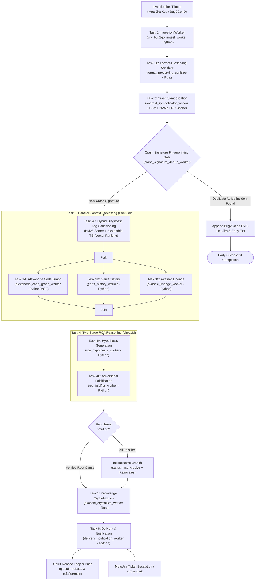

# Spec 0002: Conductor OEM Android Root Cause Analysis Pipeline

## 1. Problem Statement

Mean Time to Detect (MTTD) and Mean Time to Resolve (MTTR) for Motorola OEM Android soak crashes and diagnostic packages present a persistent bottleneck across device development lifecycles. Soak test fleets—consisting of hundreds of automated and field test devices executing continuous regression sweeps—generate hundreds of Bug2Go diagnostic packages and crash logs weekly.

When a soak crash occurs, triaging engineers face significant diagnostic hurdles:
1. **Heterogeneous Crash Formats**: Crashes manifest as Java/Kotlin unhandled runtime exceptions, native C/C++ tombstone dumps (`SIGSEGV`, `SIGBUS`, `SIGABRT`), Android Not Responding (ANR) watchdog traces, or kernel panics.
2. **Artifact Disconnect & Obfuscation**: Native tombstone frames contain raw memory addresses requiring matching unstripped OEM shared objects (`.so`) for deterministic Symbolication. Application stack traces are obfuscated with Proguard/R8, requiring exact mapping files tied to ephemeral OEM build fingerprints.
3. **Multi-Repository Scale**: OEM Android architectures span dozens of distinct Git repositories (OEM device overlays, vendor hardware abstraction layers, Android framework adaptations, proprietary OEM system applications). Tracing blast radius and call chains across repositories manually takes hours.
4. **Merge Velocity vs. Blame**: Between nightly soak builds, dozens of Gerrit changes (CLs) merge into release branches. Pinpointing which specific commit introduced a regression requires painstaking git blame and commit range cross-referencing.
5. **LLM Hallucination and Spurious Correlation**: Monolithic, single-pass LLM prompts frequently generate spurious correlations, falsely blaming innocent Gerrit changes merely because they modified an adjacent method or shared a source file touched during the same soak cycle.
6. **Knowledge Loss & Repetitive Triaging**: Diagnostic findings are typically left in informal MotoJira comments. Without systematic Crystallization into a validated graph Vault, historical context, prior regression fixes, and supersession lineages are lost to future investigations.

---

## 2. Solution Overview

This specification establishes an automated, durable, end-to-end Root Cause Analysis pipeline governed by **Netflix/Orkes Conductor**. The architecture combines native Rust binaries for compute-intensive Symbolication, sanitization, log scoring, and Vault linting with Python workers for distributed orchestration, Code Graph navigation via MCP, and adversarial two-stage LLM reasoning.



The pipeline enforces five foundational guarantees:
- **Durable Orchestration**: Every investigation step is checkpointed in Conductor; transient network drops, rate limits, or worker restarts do not corrupt or restart the investigation.
- **Polyglot Runtime Specialization**: CPU-heavy, memory-sensitive operations (addr2line, Proguard deobfuscation, tombstone parsing, `format_preserving_sanitizer`, `bm25_log_window_scorer`, `akashic lint`) execute in native Rust with a local NVMe-backed Symbol Store LRU cache (ADR 0002). Dynamic polling, external APIs, and AI integrations execute in Python.
- **Crash Signature Fingerprinting Gate**: Following symbolication, a deterministic SHA-256 crash signature is evaluated (`sha256(app_id + exception_or_signal + top_3_symbolicated_app_frames)`). If an active `Incident` already exists in the Vault with this signature, downstream reasoning is bypassed, the Bug2Go logs are appended as an `EVD-` node, MotoJira is cross-linked, and the workflow terminates early with success.
- **Hybrid Diagnostic Log Conditioning**: High-density diagnostic logs are condensed through deterministic crash/thread slicing, fast BM25 lexical windowing, and dense vector ranking via Alexandria TEI sidecars running `bge-large-en-v1.5`.
- **Adversarial Falsification & Inconclusive Handling**: LLM reasoning is split into two stages: generating candidate Hypotheses, followed by strict adversarial stress-testing against hard empirical Evidence. If all candidate Hypotheses are falsified, the workflow branches to `status: inconclusive`, recording falsification rationales and escalating diagnostic gaps in MotoJira.
- **On-Demand Crystallization & Gerrit Push Rebase Loop**: Verified conclusions crystallize into canonical Akashic Markdown nodes, pass strict `akashic lint` validation, rebase cleanly via `git pull --rebase origin main` against the Vault project (configured with Gerrit submit type `Rebase If Necessary`), and submit to Gerrit (`refs/for/main`) for engineer review (ADR 0001, ADR 0003).

---

## 3. Workflow DAG Architecture

### Task 1: Ingestion & Sanitization (`jira_bug2go_ingest_worker` - Python, `format_preserving_sanitizer` - Rust)
- **Role**: Serves as the pipeline entry point triggered by an Investigation Trigger (e.g., MotoJira key like `MOTOCAM-9102` or Bug2Go identifier `B2G-882194`).
- **Operation**:
  1. Authenticates against MotoJira REST API and fetches the issue metadata and associated diagnostic archives.
  2. Unpacks the Bug2Go archive in memory or temporary workspace.
  3. Extracts device metadata: `ro.build.fingerprint`, `ro.product.device`, Android OS version, target package ID.
  4. Extracts diagnostic streams: raw tombstone files (`/data/tombstones/*`), system logcat, crash logcat, event logcat, and ANR traces.
  5. Passes all text streams through the native Rust `format_preserving_sanitizer` to replace sensitive user PII with typed tokens (e.g., `<PHONE:US_VALID_10DIGIT>`, `<IMEI:VALID_15DIGIT>`) and scrub OEM secrets.
- **Runtime**: Python 3.11+ ingest orchestrator invoking Rust native sanitization binary.

### Task 2: Crash Symbolication (`android_symbolicator_worker` - Rust)
- **Role**: Performs deterministic Symbolication of native memory addresses and deobfuscation of Java/Kotlin stack frames using a local NVMe-backed Symbol Store LRU cache.
- **Operation**:
  1. Checks the local NVMe Symbol Store LRU cache for unstripped ELF binaries and R8 Proguard `mapping.txt` matching `ro.build.fingerprint`. On cache miss, pulls from OEM build artifact repositories and stores locally.
  2. For JVM crashes: loads Proguard/R8 `mapping.txt`; translates obfuscated class/method names and source line offsets into canonical source symbols.
  3. For native crashes: parses tombstone header, signal number (`SIGSEGV`, `SIGBUS`, etc.), fault address (`fault addr 0x...`), and CPU register states (`pc`, `lr`, `sp`). Resolves unstripped shared library symbols (`.so`) using `addr2line` / `llvm-symbolizer`.
  4. Generates a normalized call stack with confirmed source repositories, relative file paths, function symbols, and line numbers.
  5. Computes the deterministic SHA-256 crash signature: `sha256(app_id + exception_or_signal + top_3_symbolicated_app_frames)`.
- **Runtime**: Native Rust binary worker.

### Task 2.5: Crash Signature Fingerprinting Gate (`crash_signature_dedup_worker` - Python/Rust)
- **Role**: Evaluates incoming crash signatures against the active Akashic Vault to prevent duplicate reasoning during soak crash storms.
- **Operation**:
  1. Queries the application Vault (`akashic/<app_id>`) for an active `Incident` node sharing the exact `crash_signature`.
  2. **If Active Incident Exists**:
     - Formats incoming Bug2Go diagnostic logs as a new Evidence node (`EVD-<JIRA_KEY>-BUG2GO.md`).
     - Appends the Evidence reference to the existing active `Incident` node.
     - Posts a comment on the incoming MotoJira ticket linking to the existing `Incident` and its Gerrit review CL.
     - Sets workflow output `deduplicated: true` and routes directly to early successful completion.
  3. **If No Active Incident Exists**:
     - Marks `deduplicated: false` and routes to Task 2C (Hybrid Diagnostic Log Conditioning).

### Task 2.6: Hybrid Diagnostic Log Conditioning (`hybrid_log_conditioning_worker` - Python + Rust)
- **Role**: Condenses multi-gigabyte log archives into a dense, high-signal diagnostic window for LLM reasoning.
- **Operation**:
  1. Deterministically isolates the crashing thread and synchronous IPC binder peer threads.
  2. Executes `bm25_log_window_scorer` (Rust) to score contiguous 50-line log windows against fault keywords and error tags.
  3. Vectorizes top candidate windows using Alexandria's local TEI inference sidecar running `bge-large-en-v1.5`.
  4. Reranks and selects the top 5 most semantically relevant diagnostic windows to pass to reasoning workers.

### Task 3: Fork-Join Parallel Context Harvesting
A Conductor `FORK_JOIN` task executing three parallel harvesters across decoupled systems:

#### Task 3A: Code Graph Harvesting (`alexandria_code_graph_worker` - Python)
- **Role**: Explores symbol structural dependencies and blast radius via Alexandria Code Graph MCP interface (ADR 0004).
- **Operation**:
  1. Connects to `alexandria-cli mcp` over standard I/O.
  2. Queries incoming callers, outgoing callees, and impacted interface boundaries for all faulting symbols.
  3. Computes the blast radius score and identifies critical upstream invocation entrypoints.

#### Task 3B: Gerrit History Harvesting (`gerrit_history_worker` - Python)
- **Role**: Identifies suspect code modifications merged between soak builds.
- **Operation**:
  1. Queries Gerrit REST/SSH for `git blame` against the symbolicated faulting source lines.
  2. Resolves the commit range between the last known passing soak build and the failing soak build fingerprint.
  3. Filters merged Gerrit changes (CLs) that modified the faulting files, related packages, or callers identified by Alexandria.
  4. Extracts commit author, Change-Id, commit message, and full file diffs.

#### Task 3C: Akashic Lineage Harvesting (`akashic_lineage_worker` - Python)
- **Role**: Discovers historical incidents and prior regression fixes in the Vault.
- **Operation**:
  1. Executes `akashic query --mode lineage` and `--mode historical` in the application Vault (`akashic/<app_id>`).
  2. Locates historical `Incident` nodes sharing matching crash signatures or faulting components.
  3. Identifies past architectural decisions or fixes that were superseded or reverted (ADR 0003).

### Task 4: Two-Stage RCA Reasoning (Python + LiteLLM)

#### Task 4A: Hypothesis Generation (`rca_hypothesis_worker` - Python)
- **Role**: Stage 1 inductive synthesis.
- **Operation**:
  1. Ingests the conditioned context from Tasks 2, 2.6, 3A, 3B, and 3C.
  2. Generates 1 to 3 distinct candidate Hypotheses explaining the failure mechanism.
  3. For each candidate Hypothesis, specifies:
     - Proposed Root Cause category.
     - Step-by-step causal chain linking trigger conditions to crash manifestation.
     - Primary suspect Gerrit change (if applicable).
     - Initial confidence rating and supporting Evidence points.

#### Task 4B: Adversarial Falsification (`rca_falsifier_worker` - Python)
- **Role**: Stage 2 adversarial deduction and stress-testing.
- **Operation**:
  1. Acts as an adversarial critic subjecting each candidate Hypothesis to empirical falsification rules:
     - **AST Reachability Rule**: Is the suspect commit reachable from the crash call stack according to the Alexandria Code Graph? If unreachable, hypothesis is falsified.
     - **Logcat Sequence Rule**: Does the logcat timestamp sequence support the causal sequence? If a crash preceded the suspect method call or an alternate error occurred first, hypothesis is falsified.
     - **Register & Memory State Rule**: Does the tombstone register state (e.g. `fault addr 0x0`, zeroed registers) match the hypothesized code defect?
     - **Guard Check Invariance Rule**: Does the source diff show an existing guard or null-check that would prevent the hypothesized failure?
  2. Logs every rejected Hypothesis with an explicit falsification rationale and counter-evidence.
  3. **Inconclusive Handling**: If all candidate Hypotheses are falsified, sets outcome status to `inconclusive`. Records explicit falsification rationales and diagnostic gaps for Jira escalation.
  4. If a hypothesis survives, promotes it as the authoritative verified Root Cause.

### Task 5: Knowledge Crystallization (`akashic_crystallize_worker` - Rust)
- **Role**: Transforms ephemeral findings into immutable Vault nodes and validates structural integrity (ADR 0001).
- **Operation**:
  1. Generates typed Akashic Markdown files using deterministic OKF v0.2 node IDs:
     - `Incident` node (`id: INC-<JIRA_KEY>`, `type: Incident`, scope, relations: `caused_by`, `supported_by`).
     - `Evidence` node (`id: EVD-<JIRA_KEY>-STACK`, `id: EVD-<JIRA_KEY>-BUG2GO`, `type: Evidence`, scope, symbolicated stack trace, tombstone dump, conditioned logcat).
     - `Resolution` node (`id: RES-<JIRA_KEY>-<SEQ>`, `type: Resolution`, `status`, `remediation_type`, forward `supersedes:` relation if replacing an earlier workaround).
  2. Enforces forward-only relations rule (`supersedes` on successor, no inverse `superseded_by` or `resolved_by`).
  3. Executes `akashic lint` against the target Vault directory.
  4. Commits validated files into a local Git worktree on branch `rca/<jira-key>`.
- **Runtime**: Native Rust binary worker.

### Task 6: Delivery & Notification (`delivery_notification_worker` - Python)
- **Role**: Submits findings to Gerrit code review via a rebase loop and updates MotoJira.
- **Operation**:
  1. **Gerrit Push Rebase Loop**:
     - Executes `git fetch origin main && git pull --rebase origin main` before pushing.
     - If concurrent commits occurred on the Vault repository, re-runs `akashic lint` on the rebased tree.
     - Pushes the rebased commit to Gerrit: `git push origin HEAD:refs/for/main%topic=rca-<jira-key>`.
     - Vault repository submit type in Gerrit is configured as `Rebase If Necessary`.
  2. Captures generated Gerrit Change-Id and review URL.
  3. Formats an authoritative RCA summary comment and posts it to the MotoJira ticket:
     - Verified Root Cause description (or Inconclusive status with diagnostic gaps).
     - Winning confidence score.
     - Falsification report explaining why alternate hypotheses were rejected.
     - Link to the Gerrit review CL (`refs/for/main`).
     - Reference to the crystallized Akashic Incident node.
- **Runtime**: Python 3.11+.

---

## 4. Task Input & Output JSON Schemas

### Task 1: `jira_bug2go_ingest_worker`

#### Input Schema
```json
{
  "$schema": "https://json-schema.org/draft/2020-12/schema",
  "title": "JiraBug2GoIngestInput",
  "type": "object",
  "required": ["investigation_trigger_id"],
  "properties": {
    "investigation_trigger_id": {
      "type": "string",
      "description": "MotoJira issue key (e.g. MOTOCAM-9102) or Bug2Go identifier (e.g. B2G-882194)"
    },
    "jira_host": {
      "type": "string",
      "description": "Optional MotoJira instance hostname override"
    }
  },
  "additionalProperties": false
}
```

#### Output Schema
```json
{
  "$schema": "https://json-schema.org/draft/2020-12/schema",
  "title": "JiraBug2GoIngestOutput",
  "type": "object",
  "required": [
    "jira_key",
    "bug2go_id",
    "app_id",
    "device",
    "android_version",
    "build_fingerprint",
    "raw_stack_trace",
    "tombstone_content",
    "logcat_excerpt"
  ],
  "properties": {
    "jira_key": { "type": "string" },
    "bug2go_id": { "type": "string" },
    "app_id": { "type": "string", "description": "e.g. com.motorola.camera3" },
    "device": { "type": "string", "description": "Device product name, e.g. falcon" },
    "android_version": { "type": "string", "description": "e.g. 14" },
    "build_fingerprint": { "type": "string", "description": "Full ro.build.fingerprint string" },
    "raw_stack_trace": { "type": "string", "description": "Raw unparsed stack trace or tombstone backtrace" },
    "tombstone_content": { "type": "string", "description": "Complete tombstone dump if native crash, or empty string" },
    "logcat_excerpt": { "type": "string", "description": "Relevant logcat timeline preceding and including crash" }
  },
  "additionalProperties": false
}
```

---

### Task 2: `android_symbolicator_worker`

#### Input Schema
```json
{
  "$schema": "https://json-schema.org/draft/2020-12/schema",
  "title": "AndroidSymbolicatorInput",
  "type": "object",
  "required": ["raw_stack_trace", "build_fingerprint", "app_id"],
  "properties": {
    "raw_stack_trace": { "type": "string" },
    "tombstone_content": { "type": "string" },
    "build_fingerprint": { "type": "string" },
    "app_id": { "type": "string" }
  },
  "additionalProperties": false
}
```

#### Output Schema
```json
{
  "$schema": "https://json-schema.org/draft/2020-12/schema",
  "title": "AndroidSymbolicatorOutput",
  "type": "object",
  "required": [
    "crash_signature",
    "is_native_crash",
    "symbolicated_stack_trace",
    "faulting_symbol",
    "symbol_locations",
    "evidence_payload"
  ],
  "properties": {
    "crash_signature": {
      "type": "string",
      "description": "Deterministic SHA-256 hash sha256(app_id + exception_or_signal + top_3_symbolicated_app_frames)"
    },
    "is_native_crash": { "type": "boolean" },
    "symbolicated_stack_trace": { "type": "string" },
    "faulting_symbol": {
      "type": "object",
      "required": ["file", "line", "symbol"],
      "properties": {
        "file": { "type": "string" },
        "line": { "type": "integer" },
        "symbol": { "type": "string" },
        "class_name": { "type": "string" }
      }
    },
    "symbol_locations": {
      "type": "array",
      "items": {
        "type": "object",
        "required": ["frame_index", "file", "line", "symbol"],
        "properties": {
          "frame_index": { "type": "integer" },
          "file": { "type": "string" },
          "line": { "type": "integer" },
          "symbol": { "type": "string" }
        }
      }
    },
    "evidence_payload": {
      "type": "object",
      "description": "Structured payload for Akashic Evidence node"
    }
  },
  "additionalProperties": false
}
```

---

### Task 2.5: `crash_signature_dedup_worker`

#### Input Schema
```json
{
  "$schema": "https://json-schema.org/draft/2020-12/schema",
  "title": "CrashSignatureDedupInput",
  "type": "object",
  "required": ["app_id", "crash_signature", "jira_key", "bug2go_id"],
  "properties": {
    "app_id": { "type": "string" },
    "crash_signature": { "type": "string" },
    "jira_key": { "type": "string" },
    "bug2go_id": { "type": "string" }
  },
  "additionalProperties": false
}
```

#### Output Schema
```json
{
  "$schema": "https://json-schema.org/draft/2020-12/schema",
  "title": "CrashSignatureDedupOutput",
  "type": "object",
  "required": ["is_duplicate", "dedup_decision"],
  "properties": {
    "is_duplicate": { "type": "boolean" },
    "matched_incident_id": { "type": ["string", "null"] },
    "dedup_decision": {
      "type": "string",
      "enum": ["PROCEED_WITH_INVESTIGATION", "APPENDED_EVD_AND_LINKED_JIRA"]
    },
    "evidence_node_path": { "type": ["string", "null"] }
  },
  "additionalProperties": false
}
```

---

### Task 2.6: `hybrid_log_conditioning_worker`

#### Input Schema
```json
{
  "$schema": "https://json-schema.org/draft/2020-12/schema",
  "title": "HybridLogConditioningInput",
  "type": "object",
  "required": ["raw_logcat", "symbolicated_stack_trace", "app_id"],
  "properties": {
    "raw_logcat": { "type": "string" },
    "symbolicated_stack_trace": { "type": "string" },
    "app_id": { "type": "string" },
    "faulting_thread_id": { "type": ["integer", "null"] }
  },
  "additionalProperties": false
}
```

#### Output Schema
```json
{
  "$schema": "https://json-schema.org/draft/2020-12/schema",
  "title": "HybridLogConditioningOutput",
  "type": "object",
  "required": ["conditioned_logcat", "selected_windows_count"],
  "properties": {
    "conditioned_logcat": { "type": "string" },
    "selected_windows_count": { "type": "integer" },
    "top_bm25_score": { "type": "number" },
    "top_tei_similarity": { "type": "number" }
  },
  "additionalProperties": false
}
```

---

### Task 3A: `alexandria_code_graph_worker`

#### Input Schema
```json
{
  "$schema": "https://json-schema.org/draft/2020-12/schema",
  "title": "AlexandriaCodeGraphInput",
  "type": "object",
  "required": ["symbol_locations", "app_id"],
  "properties": {
    "symbol_locations": {
      "type": "array",
      "items": {
        "type": "object",
        "required": ["file", "line", "symbol"],
        "properties": {
          "file": { "type": "string" },
          "line": { "type": "integer" },
          "symbol": { "type": "string" }
        }
      }
    },
    "app_id": { "type": "string" }
  },
  "additionalProperties": false
}
```

#### Output Schema
```json
{
  "$schema": "https://json-schema.org/draft/2020-12/schema",
  "title": "AlexandriaCodeGraphOutput",
  "type": "object",
  "required": ["callers", "callees", "blast_radius_score", "impacted_symbols"],
  "properties": {
    "callers": {
      "type": "array",
      "items": { "type": "string" },
      "description": "List of direct callers of the faulting symbol"
    },
    "callees": {
      "type": "array",
      "items": { "type": "string" },
      "description": "List of direct callees invoked from the faulting symbol"
    },
    "blast_radius_score": { "type": "number", "minimum": 0.0, "maximum": 1.0 },
    "impacted_symbols": {
      "type": "array",
      "items": { "type": "string" }
    },
    "graph_context_summary": { "type": "string" }
  },
  "additionalProperties": false
}
```

---

### Task 3B: `gerrit_history_worker`

#### Input Schema
```json
{
  "$schema": "https://json-schema.org/draft/2020-12/schema",
  "title": "GerritHistoryInput",
  "type": "object",
  "required": ["build_fingerprint", "symbol_locations", "app_id"],
  "properties": {
    "build_fingerprint": { "type": "string" },
    "symbol_locations": {
      "type": "array",
      "items": {
        "type": "object",
        "required": ["file", "line", "symbol"],
        "properties": {
          "file": { "type": "string" },
          "line": { "type": "integer" },
          "symbol": { "type": "string" }
        }
      }
    },
    "app_id": { "type": "string" }
  },
  "additionalProperties": false
}
```

#### Output Schema
```json
{
  "$schema": "https://json-schema.org/draft/2020-12/schema",
  "title": "GerritHistoryOutput",
  "type": "object",
  "required": ["blame_commits", "candidate_changes"],
  "properties": {
    "blame_commits": {
      "type": "array",
      "items": {
        "type": "object",
        "required": ["commit_hash", "author", "date", "file", "line"],
        "properties": {
          "commit_hash": { "type": "string" },
          "author": { "type": "string" },
          "date": { "type": "string" },
          "file": { "type": "string" },
          "line": { "type": "integer" },
          "subject": { "type": "string" }
        }
      }
    },
    "candidate_changes": {
      "type": "array",
      "items": {
        "type": "object",
        "required": ["change_id", "cl_number", "subject", "author", "diff_patch"],
        "properties": {
          "change_id": { "type": "string" },
          "cl_number": { "type": "integer" },
          "subject": { "type": "string" },
          "author": { "type": "string" },
          "diff_patch": { "type": "string" }
        }
      }
    }
  },
  "additionalProperties": false
}
```

---

### Task 3C: `akashic_lineage_worker`

#### Input Schema
```json
{
  "$schema": "https://json-schema.org/draft/2020-12/schema",
  "title": "AkashicLineageInput",
  "type": "object",
  "required": ["crash_signature", "app_id"],
  "properties": {
    "crash_signature": { "type": "string" },
    "app_id": { "type": "string" }
  },
  "additionalProperties": false
}
```

#### Output Schema
```json
{
  "$schema": "https://json-schema.org/draft/2020-12/schema",
  "title": "AkashicLineageOutput",
  "type": "object",
  "required": ["matched_incidents", "related_decisions", "superseded_fixes"],
  "properties": {
    "matched_incidents": {
      "type": "array",
      "items": {
        "type": "object",
        "required": ["incident_id", "title", "status", "root_cause_summary"],
        "properties": {
          "incident_id": { "type": "string" },
          "title": { "type": "string" },
          "status": { "type": "string" },
          "root_cause_summary": { "type": "string" }
        }
      }
    },
    "related_decisions": {
      "type": "array",
      "items": {
        "type": "object",
        "required": ["decision_id", "title"],
        "properties": {
          "decision_id": { "type": "string" },
          "title": { "type": "string" }
        }
      }
    },
    "superseded_fixes": {
      "type": "array",
      "items": { "type": "string" }
    }
  },
  "additionalProperties": false
}
```

---

### Task 4A: `rca_hypothesis_worker`

#### Input Schema
```json
{
  "$schema": "https://json-schema.org/draft/2020-12/schema",
  "title": "RcaHypothesisInput",
  "type": "object",
  "required": ["crash_details", "code_graph_context", "gerrit_context", "vault_lineage_context"],
  "properties": {
    "crash_details": { "type": "object" },
    "code_graph_context": { "type": "object" },
    "gerrit_context": { "type": "object" },
    "vault_lineage_context": { "type": "object" }
  },
  "additionalProperties": false
}
```

#### Output Schema
```json
{
  "$schema": "https://json-schema.org/draft/2020-12/schema",
  "title": "RcaHypothesisOutput",
  "type": "object",
  "required": ["hypotheses"],
  "properties": {
    "hypotheses": {
      "type": "array",
      "minItems": 1,
      "maxItems": 3,
      "items": {
        "type": "object",
        "required": [
          "id",
          "title",
          "proposed_root_cause",
          "causal_chain",
          "suspect_gerrit_cl",
          "supporting_evidence_points",
          "initial_confidence"
        ],
        "properties": {
          "id": { "type": "string" },
          "title": { "type": "string" },
          "proposed_root_cause": { "type": "string" },
          "causal_chain": { "type": "string" },
          "suspect_gerrit_cl": { "type": "string" },
          "supporting_evidence_points": {
            "type": "array",
            "items": { "type": "string" }
          },
          "initial_confidence": { "type": "number", "minimum": 0.0, "maximum": 1.0 }
        }
      }
    }
  },
  "additionalProperties": false
}
```

---

### Task 4B: `rca_falsifier_worker`

#### Input Schema
```json
{
  "$schema": "https://json-schema.org/draft/2020-12/schema",
  "title": "RcaFalsifierInput",
  "type": "object",
  "required": ["hypotheses", "crash_details", "raw_logs", "tombstone_content", "gerrit_commits"],
  "properties": {
    "hypotheses": {
      "type": "array",
      "items": { "type": "object" }
    },
    "crash_details": { "type": "object" },
    "raw_logs": { "type": "string" },
    "tombstone_content": { "type": "string" },
    "gerrit_commits": { "type": "array", "items": { "type": "object" } }
  },
  "additionalProperties": false
}
```

#### Output Schema
```json
{
  "$schema": "https://json-schema.org/draft/2020-12/schema",
  "title": "RcaFalsifierOutput",
  "type": "object",
  "required": [
    "status",
    "falsified_hypotheses",
    "root_cause",
    "confidence_score",
    "summary"
  ],
  "properties": {
    "status": {
      "type": "string",
      "enum": ["VERIFIED", "INCONCLUSIVE"]
    },
    "winning_hypothesis": {
      "type": ["object", "null"],
      "properties": {
        "id": { "type": "string" },
        "title": { "type": "string" },
        "verified_root_cause": { "type": "string" },
        "causal_mechanism": { "type": "string" },
        "suspect_gerrit_cl": { "type": "string" }
      }
    },
    "falsified_hypotheses": {
      "type": "array",
      "items": {
        "type": "object",
        "required": ["id", "falsification_rationale", "counter_evidence"],
        "properties": {
          "id": { "type": "string" },
          "falsification_rationale": { "type": "string" },
          "counter_evidence": { "type": "string" }
        }
      }
    },
    "root_cause": { "type": "string" },
    "confidence_score": { "type": "number", "minimum": 0.0, "maximum": 1.0 },
    "summary": { "type": "string" },
    "diagnostic_gaps": {
      "type": "array",
      "items": { "type": "string" }
    },
    "verified_incident": {
      "type": ["object", "null"],
      "properties": {
        "title": { "type": "string" },
        "root_cause_summary": { "type": "string" },
        "causal_decision_ref": { "type": "string" }
      }
    }
  },
  "additionalProperties": false
}
```

---

### Task 5: `akashic_crystallize_worker`

#### Input Schema
```json
{
  "$schema": "https://json-schema.org/draft/2020-12/schema",
  "title": "AkashicCrystallizeInput",
  "type": "object",
  "required": [
    "investigation_trigger_id",
    "jira_key",
    "app_id",
    "device",
    "android_version",
    "status",
    "symbolicated_evidence"
  ],
  "properties": {
    "investigation_trigger_id": { "type": "string" },
    "jira_key": { "type": "string" },
    "app_id": { "type": "string" },
    "device": { "type": "string" },
    "android_version": { "type": "string" },
    "status": { "type": "string", "enum": ["VERIFIED", "INCONCLUSIVE"] },
    "verified_incident": { "type": ["object", "null"] },
    "symbolicated_evidence": { "type": "object" },
    "falsification_rationales": {
      "type": "array",
      "items": { "type": "object" }
    }
  },
  "additionalProperties": false
}
```

#### Output Schema
```json
{
  "$schema": "https://json-schema.org/draft/2020-12/schema",
  "title": "AkashicCrystallizeOutput",
  "type": "object",
  "required": [
    "incident_node_path",
    "evidence_node_path",
    "crystallized_nodes",
    "lint_status",
    "git_commit_sha"
  ],
  "properties": {
    "incident_node_path": { "type": "string" },
    "evidence_node_path": { "type": "string" },
    "crystallized_nodes": {
      "type": "array",
      "items": { "type": "string" }
    },
    "lint_status": {
      "type": "string",
      "enum": ["PASSED", "FAILED"]
    },
    "git_commit_sha": { "type": "string" }
  },
  "additionalProperties": false
}
```

---

### Task 6: `delivery_notification_worker`

#### Input Schema
```json
{
  "$schema": "https://json-schema.org/draft/2020-12/schema",
  "title": "DeliveryNotificationInput",
  "type": "object",
  "required": [
    "jira_key",
    "crystallized_nodes",
    "rca_summary",
    "root_cause",
    "confidence_score",
    "git_commit_sha"
  ],
  "properties": {
    "jira_key": { "type": "string" },
    "crystallized_nodes": { "type": "array", "items": { "type": "string" } },
    "rca_summary": { "type": "string" },
    "root_cause": { "type": "string" },
    "confidence_score": { "type": "number" },
    "git_commit_sha": { "type": "string" },
    "status": { "type": "string", "enum": ["VERIFIED", "INCONCLUSIVE", "DUPLICATE_INCIDENT_APPENDED"] }
  },
  "additionalProperties": false
}
```

#### Output Schema
```json
{
  "$schema": "https://json-schema.org/draft/2020-12/schema",
  "title": "DeliveryNotificationOutput",
  "type": "object",
  "required": ["status", "gerrit_change_url", "jira_comment_id"],
  "properties": {
    "status": { "type": "string", "enum": ["DELIVERED", "FAILED"] },
    "gerrit_change_url": { "type": "string" },
    "jira_comment_id": { "type": "string" }
  },
  "additionalProperties": false
}
```

---

### Task: `arch_reconciliation_worker`

#### Input Schema
```json
{
  "$schema": "https://json-schema.org/draft/2020-12/schema",
  "title": "ArchReconciliationInput",
  "type": "object",
  "required": ["repo_name", "commit_sha", "structural_diff", "affected_subsystems"],
  "properties": {
    "repo_name": { "type": "string" },
    "commit_sha": { "type": "string" },
    "structural_diff": { "type": "string" },
    "affected_subsystems": {
      "type": "array",
      "items": { "type": "string" }
    }
  },
  "additionalProperties": false
}
```

#### Output Schema
```json
{
  "$schema": "https://json-schema.org/draft/2020-12/schema",
  "title": "ArchReconciliationOutput",
  "type": "object",
  "required": ["updated_arch_nodes", "lint_status", "git_commit_sha"],
  "properties": {
    "updated_arch_nodes": {
      "type": "array",
      "items": { "type": "string" }
    },
    "lint_status": { "type": "string", "enum": ["PASSED", "FAILED"] },
    "git_commit_sha": { "type": "string" }
  },
  "additionalProperties": false
}
```

---

## 5. Conductor Workflow Definition JSON

### Pipeline 1: Root Cause Analysis Pipeline (`oem_android_rca_pipeline`)

The complete RCA workflow definition adheres to the Netflix/Orkes Conductor JSON workflow specification (schema version 2), incorporating the format-preserving sanitizer, the Crash Signature Fingerprinting Gate, and hybrid diagnostic log conditioning:

```json
{
  "name": "oem_android_rca_pipeline",
  "description": "Automated durable Root Cause Analysis pipeline for Motorola OEM Android soak crashes and Bug2Go tickets",
  "version": 1,
  "tasks": [
    {
      "name": "jira_bug2go_ingest_task",
      "taskReferenceName": "jira_bug2go_ingest_ref",
      "type": "SIMPLE",
      "inputParameters": {
        "investigation_trigger_id": "${workflow.input.investigation_trigger_id}",
        "jira_host": "${workflow.input.jira_host}"
      },
      "retryCount": 3,
      "retryLogic": "EXPONENTIAL_BACKOFF",
      "retryDelaySeconds": 10,
      "timeoutSeconds": 300,
      "responseTimeoutSeconds": 120
    },
    {
      "name": "android_symbolicator_task",
      "taskReferenceName": "android_symbolicator_ref",
      "type": "SIMPLE",
      "inputParameters": {
        "raw_stack_trace": "${jira_bug2go_ingest_ref.output.raw_stack_trace}",
        "tombstone_content": "${jira_bug2go_ingest_ref.output.tombstone_content}",
        "build_fingerprint": "${jira_bug2go_ingest_ref.output.build_fingerprint}",
        "app_id": "${jira_bug2go_ingest_ref.output.app_id}"
      },
      "retryCount": 2,
      "retryLogic": "FIXED",
      "retryDelaySeconds": 5,
      "timeoutSeconds": 180,
      "responseTimeoutSeconds": 60
    },
    {
      "name": "crash_signature_dedup_task",
      "taskReferenceName": "crash_signature_dedup_ref",
      "type": "SIMPLE",
      "inputParameters": {
        "app_id": "${jira_bug2go_ingest_ref.output.app_id}",
        "crash_signature": "${android_symbolicator_ref.output.crash_signature}",
        "jira_key": "${jira_bug2go_ingest_ref.output.jira_key}",
        "bug2go_id": "${jira_bug2go_ingest_ref.output.bug2go_id}"
      },
      "retryCount": 2,
      "timeoutSeconds": 60,
      "responseTimeoutSeconds": 30
    },
    {
      "name": "switch_crash_signature_dedup",
      "taskReferenceName": "switch_dedup_ref",
      "type": "SWITCH",
      "evaluatorType": "value-param",
      "expression": "dedup_decision",
      "inputParameters": {
        "dedup_decision": "${crash_signature_dedup_ref.output.dedup_decision}"
      },
      "decisionCases": {
        "APPENDED_EVD_AND_LINKED_JIRA": [
          {
            "name": "delivery_notification_task",
            "taskReferenceName": "dedup_delivery_ref",
            "type": "SIMPLE",
            "inputParameters": {
              "jira_key": "${jira_bug2go_ingest_ref.output.jira_key}",
              "crystallized_nodes": ["${crash_signature_dedup_ref.output.evidence_node_path}"],
              "rca_summary": "Duplicate soak crash signature detected. Evidence appended to existing active incident.",
              "root_cause": "Deduplicated against active Incident: ${crash_signature_dedup_ref.output.matched_incident_id}",
              "confidence_score": 1.0,
              "git_commit_sha": "N/A",
              "status": "DUPLICATE_INCIDENT_APPENDED"
            },
            "retryCount": 2,
            "timeoutSeconds": 60
          }
        ]
      },
      "defaultCase": [
        {
          "name": "hybrid_log_conditioning_task",
          "taskReferenceName": "hybrid_log_conditioning_ref",
          "type": "SIMPLE",
          "inputParameters": {
            "raw_logcat": "${jira_bug2go_ingest_ref.output.logcat_excerpt}",
            "symbolicated_stack_trace": "${android_symbolicator_ref.output.symbolicated_stack_trace}",
            "app_id": "${jira_bug2go_ingest_ref.output.app_id}"
          },
          "retryCount": 2,
          "timeoutSeconds": 120,
          "responseTimeoutSeconds": 60
        },
        {
          "name": "fork_context_harvesting",
          "taskReferenceName": "fork_context_harvesting_ref",
          "type": "FORK_JOIN",
          "forkTasks": [
            [
              {
                "name": "alexandria_code_graph_task",
                "taskReferenceName": "alexandria_code_graph_ref",
                "type": "SIMPLE",
                "inputParameters": {
                  "symbol_locations": "${android_symbolicator_ref.output.symbol_locations}",
                  "app_id": "${jira_bug2go_ingest_ref.output.app_id}"
                },
                "retryCount": 2,
                "timeoutSeconds": 120,
                "responseTimeoutSeconds": 60
              }
            ],
            [
              {
                "name": "gerrit_history_task",
                "taskReferenceName": "gerrit_history_ref",
                "type": "SIMPLE",
                "inputParameters": {
                  "build_fingerprint": "${jira_bug2go_ingest_ref.output.build_fingerprint}",
                  "symbol_locations": "${android_symbolicator_ref.output.symbol_locations}",
                  "app_id": "${jira_bug2go_ingest_ref.output.app_id}"
                },
                "retryCount": 3,
                "retryLogic": "EXPONENTIAL_BACKOFF",
                "retryDelaySeconds": 5,
                "timeoutSeconds": 180,
                "responseTimeoutSeconds": 90
              }
            ],
            [
              {
                "name": "akashic_lineage_task",
                "taskReferenceName": "akashic_lineage_ref",
                "type": "SIMPLE",
                "inputParameters": {
                  "crash_signature": "${android_symbolicator_ref.output.crash_signature}",
                  "app_id": "${jira_bug2go_ingest_ref.output.app_id}"
                },
                "retryCount": 2,
                "timeoutSeconds": 60,
                "responseTimeoutSeconds": 30
              }
            ]
          ]
        },
        {
          "name": "join_context_harvesting",
          "taskReferenceName": "join_context_harvesting_ref",
          "type": "JOIN",
          "joinOn": [
            "alexandria_code_graph_ref",
            "gerrit_history_ref",
            "akashic_lineage_ref"
          ]
        },
        {
          "name": "rca_hypothesis_task",
          "taskReferenceName": "rca_hypothesis_ref",
          "type": "SIMPLE",
          "inputParameters": {
            "crash_details": "${android_symbolicator_ref.output}",
            "code_graph_context": "${alexandria_code_graph_ref.output}",
            "gerrit_context": "${gerrit_history_ref.output}",
            "vault_lineage_context": "${akashic_lineage_ref.output}"
          },
          "retryCount": 2,
          "retryLogic": "FIXED",
          "retryDelaySeconds": 10,
          "timeoutSeconds": 240,
          "responseTimeoutSeconds": 180
        },
        {
          "name": "rca_falsifier_task",
          "taskReferenceName": "rca_falsifier_ref",
          "type": "SIMPLE",
          "inputParameters": {
            "hypotheses": "${rca_hypothesis_ref.output.hypotheses}",
            "crash_details": "${android_symbolicator_ref.output}",
            "raw_logs": "${hybrid_log_conditioning_ref.output.conditioned_logcat}",
            "tombstone_content": "${jira_bug2go_ingest_ref.output.tombstone_content}",
            "gerrit_commits": "${gerrit_history_ref.output.candidate_changes}"
          },
          "retryCount": 2,
          "retryLogic": "FIXED",
          "retryDelaySeconds": 10,
          "timeoutSeconds": 240,
          "responseTimeoutSeconds": 180
        },
        {
          "name": "akashic_crystallize_task",
          "taskReferenceName": "akashic_crystallize_ref",
          "type": "SIMPLE",
          "inputParameters": {
            "investigation_trigger_id": "${workflow.input.investigation_trigger_id}",
            "jira_key": "${jira_bug2go_ingest_ref.output.jira_key}",
            "app_id": "${jira_bug2go_ingest_ref.output.app_id}",
            "device": "${jira_bug2go_ingest_ref.output.device}",
            "android_version": "${jira_bug2go_ingest_ref.output.android_version}",
            "status": "${rca_falsifier_ref.output.status}",
            "verified_incident": "${rca_falsifier_ref.output.verified_incident}",
            "symbolicated_evidence": "${android_symbolicator_ref.output.evidence_payload}",
            "falsification_rationales": "${rca_falsifier_ref.output.falsified_hypotheses}"
          },
          "retryCount": 1,
          "timeoutSeconds": 120,
          "responseTimeoutSeconds": 60
        },
        {
          "name": "delivery_notification_task",
          "taskReferenceName": "delivery_notification_ref",
          "type": "SIMPLE",
          "inputParameters": {
            "jira_key": "${jira_bug2go_ingest_ref.output.jira_key}",
            "crystallized_nodes": "${akashic_crystallize_ref.output.crystallized_nodes}",
            "rca_summary": "${rca_falsifier_ref.output.summary}",
            "root_cause": "${rca_falsifier_ref.output.root_cause}",
            "confidence_score": "${rca_falsifier_ref.output.confidence_score}",
            "git_commit_sha": "${akashic_crystallize_ref.output.git_commit_sha}",
            "status": "${rca_falsifier_ref.output.status}"
          },
          "retryCount": 3,
          "retryLogic": "EXPONENTIAL_BACKOFF",
          "retryDelaySeconds": 10,
          "timeoutSeconds": 180,
          "responseTimeoutSeconds": 90
        }
      ]
    }
  ],
  "inputParameters": [
    "investigation_trigger_id",
    "jira_host"
  ],
  "outputParameters": {
    "jira_key": "${jira_bug2go_ingest_ref.output.jira_key}",
    "status": "${delivery_notification_ref.output.status}",
    "gerrit_change_url": "${delivery_notification_ref.output.gerrit_change_url}",
    "root_cause": "${rca_falsifier_ref.output.root_cause}",
    "confidence_score": "${rca_falsifier_ref.output.confidence_score}",
    "crystallized_incident": "${akashic_crystallize_ref.output.incident_node_path}"
  },
  "schemaVersion": 2,
  "restartable": true,
  "workflowStatusListenerEnabled": true
}
```

---

### Pipeline 2: Architecture Reconciliation Pipeline (`akashic_arch_reconciliation_pipeline`)

Triggered by Alexandria's outbound HTTP webhook when the Three-Stage Structural Significance Filter detects public API or interface mutations:

```json
{
  "name": "akashic_arch_reconciliation_pipeline",
  "description": "Continuous architectural note reconciliation triggered by Alexandria Code Graph structural AST diff events",
  "version": 1,
  "tasks": [
    {
      "name": "arch_reconciliation_task",
      "taskReferenceName": "arch_reconciliation_ref",
      "type": "SIMPLE",
      "inputParameters": {
        "repo_name": "${workflow.input.repo_name}",
        "commit_sha": "${workflow.input.commit_sha}",
        "structural_diff": "${workflow.input.structural_diff}",
        "affected_subsystems": "${workflow.input.affected_subsystems}"
      },
      "retryCount": 2,
      "timeoutSeconds": 180,
      "responseTimeoutSeconds": 90
    },
    {
      "name": "akashic_lint_task",
      "taskReferenceName": "akashic_lint_ref",
      "type": "SIMPLE",
      "inputParameters": {
        "vault_target_path": "akashic/${workflow.input.repo_name}"
      },
      "retryCount": 1,
      "timeoutSeconds": 60,
      "responseTimeoutSeconds": 30
    },
    {
      "name": "arch_gerrit_delivery_task",
      "taskReferenceName": "arch_gerrit_delivery_ref",
      "type": "SIMPLE",
      "inputParameters": {
        "updated_nodes": "${arch_reconciliation_ref.output.updated_arch_nodes}",
        "git_commit_sha": "${arch_reconciliation_ref.output.git_commit_sha}",
        "topic": "arch-sync-${workflow.input.repo_name}"
      },
      "retryCount": 3,
      "retryLogic": "EXPONENTIAL_BACKOFF",
      "retryDelaySeconds": 10,
      "timeoutSeconds": 120
    }
  ],
  "inputParameters": [
    "repo_name",
    "commit_sha",
    "structural_diff",
    "affected_subsystems"
  ],
  "outputParameters": {
    "status": "${arch_gerrit_delivery_ref.output.status}",
    "gerrit_change_url": "${arch_gerrit_delivery_ref.output.gerrit_change_url}",
    "updated_nodes": "${arch_reconciliation_ref.output.updated_arch_nodes}"
  },
  "schemaVersion": 2,
  "restartable": true
}
```

---

## 6. LiteLLM Configuration

The reasoning workers (`rca_hypothesis_worker` and `rca_falsifier_worker`) interact with LLMs through **LiteLLM**, providing uniform request formatting, fallback chaining, and environment-driven routing.

### Environment Routing Topology
- **Development**: Proxied via local OmniRoute proxy (`http://localhost:20128/v1`).
- **Production**: Routed directly to Google Cloud Vertex AI ADC (`gemini-2.5-pro` and Claude 3.5 Sonnet on Vertex AI).

### LiteLLM Proxy Configuration (`litellm-config.yaml`)

```yaml
model_list:
  # Development Environment (OmniRoute Proxy)
  - model_name: rca-hypothesis-model
    litellm_params:
      model: openai/custom-rca-dev
      api_base: http://localhost:20128/v1
      api_key: os.environ/OMNIROUTE_API_KEY
      timeout: 120
      max_retries: 2
    model_info:
      environment: dev

  - model_name: rca-falsifier-model
    litellm_params:
      model: openai/custom-falsifier-dev
      api_base: http://localhost:20128/v1
      api_key: os.environ/OMNIROUTE_API_KEY
      timeout: 120
      max_retries: 2
    model_info:
      environment: dev

  # Production Environment (Google Cloud Vertex AI)
  - model_name: rca-hypothesis-model
    litellm_params:
      model: vertex_ai/gemini-2.5-pro
      vertex_project: os.environ/VERTEX_PROJECT_ID
      vertex_location: us-central1
      vertex_credentials: os.environ/VERTEX_SERVICE_ACCOUNT_JSON
      temperature: 0.2
      timeout: 180
      max_retries: 3
    model_info:
      environment: prod

  - model_name: rca-falsifier-model
    litellm_params:
      model: vertex_ai/gemini-2.5-pro
      vertex_project: os.environ/VERTEX_PROJECT_ID
      vertex_location: us-central1
      vertex_credentials: os.environ/VERTEX_SERVICE_ACCOUNT_JSON
      temperature: 0.1
      timeout: 180
      max_retries: 3
    model_info:
      environment: prod

litellm_settings:
  drop_params: true
  set_verbose: false
  telemetry: false
  request_timeout: 180
  fallbacks:
    - rca-hypothesis-model: ["rca-hypothesis-fallback"]
    - rca-falsifier-model: ["rca-falsifier-fallback"]
```

### Python Worker Integration Pattern

Reasoning workers consume the model using standard LiteLLM completion calls with structured JSON output enforcement:

```python
import os
import json
import litellm

ENV = os.environ.get("DEPLOY_ENV", "dev")

def generate_hypotheses(context_payload: dict) -> dict:
    model_name = "rca-hypothesis-model"
    api_base = "http://localhost:20128/v1" if ENV == "dev" else None
    
    prompt = f"""
You are an expert Motorola OEM Android Root Cause Analysis engineer.
Analyze the following crash details, call graph context, and Gerrit commits.
Generate 1 to 3 distinct candidate hypotheses explaining the crash mechanism.

Context:
{json.dumps(context_payload, indent=2)}

Respond ONLY with valid JSON conforming to the RcaHypothesisOutput schema.
"""
    response = litellm.completion(
        model=model_name,
        api_base=api_base,
        messages=[{"role": "user", "content": prompt}],
        temperature=0.2,
        response_format={"type": "json_object"}
    )
    return json.loads(response.choices[0].message.content)
```

---

## 7. Testing & Verification Strategy

### Definition of a Good Test
Tests must exercise observable behavioral contracts across public task seams (JSON input to output validation, file tree state in the Vault, exit codes from `akashic lint`) rather than mocking private intermediate state representations or asserting internal prompt string concatenation.

### Verification Seams

1. **Symbolication Seam (`android_symbolicator_worker` - Rust)**:
   - Evaluates real tombstone fixtures from Motorola devices (e.g. `falcon` SIGSEGV dumps) against mock symbol directories containing unstripped shared objects and NVMe LRU cached binaries.
   - Verifies that raw addresses correctly resolve to file paths, function symbols, and line numbers.
   - Asserts deterministic SHA-256 crash signature generation.
   - Evaluates obfuscated stack traces with fixture `mapping.txt` files to verify accurate deobfuscation.

2. **Crash Signature Deduplication Seam (`crash_signature_dedup_worker`)**:
   - Ingests a duplicate Bug2Go trigger with a matching crash signature for an existing active Incident.
   - Verifies that the Conductor `SWITCH` task routes to `APPENDED_EVD_AND_LINKED_JIRA`, appending the `EVD-` node, updating MotoJira, and bypassing downstream LLM reasoning tasks.

3. **Hybrid Diagnostic Log Conditioning Seam**:
   - Ingests a multi-megabyte raw logcat fixture with noise and intermittent error lines.
   - Verifies that `bm25_log_window_scorer` selects the top lexical windows and Alexandria TEI reranks the top 5 semantically relevant segments within the 256-token budget.

4. **Context Harvesting Fork-Join Seam**:
   - Dispatches parallel execution to `alexandria_code_graph_worker` (MCP), `gerrit_history_worker`, and `akashic_lineage_worker` against fixture Git repositories.
   - Verifies that all three branch outputs synchronize correctly at the Conductor `JOIN` barrier without thread deadlock or missing keys.

5. **Two-Stage Adversarial Reasoning & Inconclusive Seam**:
   - Provides a test fixture where a Gerrit change modified the faulting source file, but was proven unreachable by the Alexandria Code Graph.
   - Verifies that `rca_hypothesis_worker` may hypothesize the correlation, but `rca_falsifier_worker` definitively falsifies and rejects it, avoiding spurious blame.
   - In a fixture where all hypotheses are falsified, verifies that the pipeline sets `status: inconclusive`, records explicit falsification rationales, and escalates to MotoJira.

6. **Gerrit Push Rebase Loop & Vault Linting Seam (`akashic_crystallize_worker`, `delivery_notification_worker`)**:
   - Simulates a concurrent commit on `origin/main` of the Vault repository during crystallization.
   - Verifies that `delivery_notification_worker` performs `git pull --rebase origin main`, re-executes `akashic lint` (verifying exit code 0), and pushes to `refs/for/main` successfully under the `Rebase If Necessary` Gerrit project policy.

7. **End-to-End Conductor Workflow Seam**:
   - Executes the complete `oem_android_rca_pipeline` in a Conductor local test harness.
   - Verifies state transitions from `RUNNING` to `COMPLETED`, validating output parameters.

---

## 8. Out of Scope

- Automatic merging of Gerrit changes into the production Vault without human engineering sign-off.
- Direct automated patching or hotfix generation in OEM Android firmware source repositories.
- Automated triage of non-Android hardware-level failures or physical power rail anomalies lacking tombstone or logcat Evidence.
