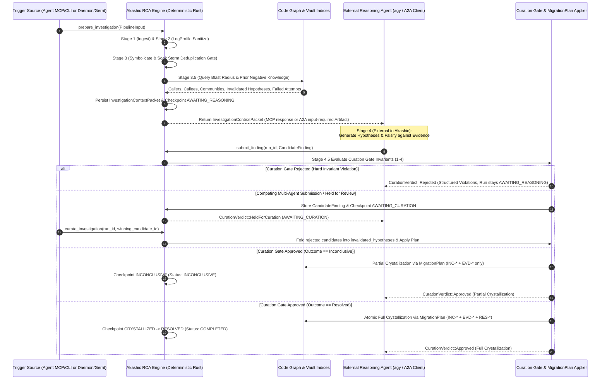

# Two-Phase Deterministic RCA Server, Investigation Context Packet, and Curation Gate

## Problem Statement

Autonomous coding agents (`agy`) and triage engineers using Akashic's Root Cause Analysis (`akashic-rca`) and background daemon (`akashic-daemon`) face five structural problems caused by the legacy `HeadlessGeminiExecutor` design:

1. **Inverted Control Flow & Recursive Agent Spawning**: When an interactive agent (`agy`) invokes the `rca_trigger` MCP tool, Akashic attempts to spawn a second headless `gemini` CLI subprocess inside Stage 4 of the Local-Host Conductor. This inverts the server/agent boundary, wastes tokens, fails when the `gemini` binary is absent or unauthenticated in the subprocess environment, and traps reasoning inside an opaque child process.
2. **Incomplete Reasoning Context**: Stage 4 previously constructed a minimal text prompt from raw symbolication output without joining the Code Graph **Blast Radius** (`upstream_callers`, `downstream_dependencies`, `impacted_communities`) or historical Vault **Negative Knowledge** (`invalidated_hypotheses`, `failed_attempts`, and prior abandoned `Resolution` nodes).
3. **Uncurated Direct-to-Disk Vault Writes**: Stage 5 wrote `Incident` (`INC-*`), `Evidence` (`EVD-*`), and `Resolution` (`RES-*`) Markdown files directly to disk prior to running `akashic-lint`, bypassing the `MigrationPlan` / `apply_plan_with_validator` atomic mutation contract from ADR 0004. As a result, an agent could propose a previously falsified hypothesis, omit adversarial falsification steps, or introduce an un-superseded **Scope** conflict that polluted the Vault on disk.
4. **Forced Resolution on Inconclusive Investigations**: When an agent falsified all candidate **Hypotheses** without identifying a verified root cause, the pipeline lacked an abstention path to record the newly discovered **Negative Knowledge** (`invalidated_hypotheses`) without fabricating a speculative `RES-*` **Resolution Node**.
5. **Broken Loop on Gerrit Abandonment & Multi-Agent Contention**: When a proposed fix CL was abandoned in Gerrit (`change-abandoned`), Akashic marked the `RES-*` node as `abandoned` but left the **Soak Storm Deduplication Gate** pointing at the old `COMPLETED` run—suppressing ongoing crash reports without queuing a follow-up investigation. Furthermore, when multiple agents analyzed the same Incident concurrently, there was no staging or adjudication mechanism to curate competing findings and preserve rejected hypotheses as **Negative Knowledge**.

## Solution

Re-architect Akashic's Root Cause Analysis into a strictly deterministic, zero-LLM **Two-Phase RCA Server and Context Engine** that supports both **Agent-Driven Mode** (interactive MCP & CLI) and **Daemon-Driven Mode** (autonomous A2A v1.0 HTTP/JSON-RPC server):

1. **Phase A (Stages 1–3.5 — Deterministic Ingestion & Investigation Context Packet Assembly)**: Akashic ingests the crash trigger (Stage 1), sanitizes logs with `LogProfile` (Stage 2), symbolicates stack frames and evaluates the **Soak Storm Deduplication Gate** (Stage 3), and joins across the Code Graph and Vault to assemble a self-contained **Investigation Context Packet** (Stage 3.5). The workflow run checkpoints in `.akashic/rca_state.db` at state **`AWAITING_REASONING`**.
2. **External Agent Reasoning (Stage 4 — Outside Akashic)**: An external reasoning agent (`agy` over MCP/CLI, or an autonomous agent over A2A v1.0) consumes the **Investigation Context Packet**, performs hypothesis generation and adversarial falsification using its own reasoning loop and read-only `graph_*` / `vault_*` tools, and submits a structured **Candidate Finding**.
3. **Phase B (Stages 4.5–6 — Curation Gate, Plan-Then-Apply Crystallization & Lifecycle)**: Akashic validates the submitted **Candidate Finding** through the deterministic **Curation Gate** (Stage 4.5)—enforcing non-regression against **Negative Knowledge**, falsification trace completeness, in-memory `MigrationPlan` lint verification, and **Scope** conflict checks. Validated findings are atomically applied to the **Vault** (Stage 5), inconclusive investigations perform **Partial Crystallization** (`INC-*` + `EVD-*` only, status `INCONCLUSIVE`), competing multi-agent findings are adjudicated via **`AWAITING_CURATION`**, and Gerrit `change-abandoned` events automatically queue a pre-linked follow-up run in `AWAITING_REASONING` (Stage 6).



## User Stories

1. As an Interactive Coding Agent (`agy`), I want `rca_trigger` (and `akashic rca prepare`) to deterministically execute Stages 1–3.5 and return a structured **Investigation Context Packet** without spawning a child LLM process, so that I can perform root cause reasoning directly within my active session.
2. As an Interactive Coding Agent (`agy`), I want the **Investigation Context Packet** to include the sanitized crash slice, symbolicated stack frames, resolved `faulting_symbol`, Code Graph **Blast Radius** (`upstream_callers`, `downstream_dependencies`, `impacted_communities`), and historical Vault **Negative Knowledge** (`invalidated_hypotheses`, `failed_attempts`), so that I have immediate architectural and historical context without manual multi-step lookups.
3. As an Interactive Coding Agent (`agy`), I want to submit my structured **Candidate Finding** via `rca_crystallize` (or `akashic rca submit-finding`), so that Akashic validates and crystallizes my root cause analysis into the canonical **Vault**.
4. As a Knowledge Base Maintainer, I want the **Curation Gate** to strictly reject any **Candidate Finding** whose `primary_hypothesis` or `remediation_proposal` repeats a previously recorded entry in `historical_invalidated_hypotheses` or `historical_failed_attempts`, so that agents cannot regress into already-disproven theories.
5. As a Knowledge Base Maintainer, I want the **Curation Gate** to strictly require non-empty `falsification_attempts` whenever a **Candidate Finding** claims a verified resolution (`outcome: resolved`), so that un-tested guesses are never crystallized as authoritative `Resolution` nodes.
6. As a Knowledge Base Maintainer, I want the **Curation Gate** to emit an advisory warning when the **Investigation Context Packet** resolved a `faulting_symbol` in the Code Graph but the submitted **Candidate Finding** fails to reference that symbol or file, so that ungrounded analyses are flagged.
7. As a Knowledge Base Maintainer, I want Stage 5 crystallization to compile all proposed `INC-*`, `EVD-*`, and `RES-*` Markdown changes into an `akashic_vault::MigrationPlan`, preview them in memory via `VaultGraph::from_dir_with_plan`, and verify zero `akashic-lint` errors and zero un-superseded `query_current` **Scope** conflicts before touching the filesystem, so that failed crystallizations never leave partial or corrupted files on disk.
8. As an Autonomous AI Coding Agent, I want to submit a **Candidate Finding** with `outcome: inconclusive` and my list of `invalidated_hypotheses` when all candidate hypotheses are falsified against empirical evidence, so that Akashic performs **Partial Crystallization** (writing `INC-*` as `active` and `EVD-*` with the falsified hypotheses while abstaining from creating a `RES-*` node) and marks the run `INCONCLUSIVE`.
9. As a Triage & RCA Engineer, I want competing **Candidate Findings** submitted by multiple agents for the same Incident to be stored in `.akashic/rca_state.db` and held at **`AWAITING_CURATION`**, so that no un-superseded **Scope** conflict is written to the Vault before adjudication.
10. As a Triage & RCA Engineer, I want to adjudicate a run in **`AWAITING_CURATION`** via `rca_curate` (or `akashic rca curate`), selecting a winning candidate (or synthesizing a curated finding) while automatically folding all rejected candidates' `primary_hypothesis` entries into the `RES-*` node's `invalidated_hypotheses` (**Negative Knowledge**), so that multi-agent explorations enrich the Vault's negative knowledge.
11. As a Platform Infrastructure Operator, I want `akashic-daemon` to expose an A2A v1.0 compliant HTTP/JSON-RPC 2.0 endpoint (`GET /.well-known/agent.json` and `POST /a2a`), so that external A2A orchestrators and agent fleets can discover Akashic's capabilities, inspect `input-required` tasks (`AWAITING_REASONING`), retrieve **Investigation Context Packets**, and submit **Candidate Findings** over standard A2A protocol primitives.
12. As a Triage & RCA Engineer, I want `GerritEvent::ChangeAbandoned` on an Incident's active Resolution CL to mark the `RES-*` node `abandoned`, record the abandonment reason in `failed_attempts`, automatically queue a new workflow run in **`AWAITING_REASONING`** pre-linked with `prior_resolution_id` and a refreshed **Investigation Context Packet**, and update `storm_signatures.active_run_id` to the new run, so that ongoing soak crashes attach to the re-opened investigation and agents immediately see why the previous fix failed.

## Implementation Decisions

### 1. Removal of Subprocess LLM Execution & Two-Phase Conductor State Machine
- Remove `HeadlessGeminiExecutor` from the RCA engine; Akashic never spawns `gemini` or any external LLM CLI binary.
- Preserve `Stage4Executor` and `MockStage4Executor` solely as an optional in-process test/adapter trait (`run_with_executor`) that bridges Phase A (`prepare_investigation`) and Phase B (`submit_finding`) in unit and integration tests.
- Expand the Conductor state machine in `.akashic/rca_state.db` with explicit two-phase and curation states:

```rust
pub enum WorkflowStage {
    Created,
    Sanitized,
    Symbolicated,
    AwaitingReasoning,   // Stage 3.5 checkpoint: InvestigationContextPacket ready
    HypothesisFalsified, // CandidateFinding accepted by Curation Gate
    AwaitingCuration,    // Held at Stage 4.5 due to competing findings or manual review flag
    Crystallized,        // MigrationPlan atomically applied to Vault
    Inconclusive,        // Partial crystallization completed (INC-* + EVD-* only, no RES-*)
    Resolved,            // Full crystallization completed (INC-* + EVD-* + RES-*)
}

pub enum WorkflowStatus {
    Running,
    AwaitingReasoning,
    AwaitingCuration,
    Inconclusive,
    Completed,
    Deduplicated,
    Failed,
}
```

### 2. Investigation Context Packet Schema (Stage 3.5)
- After Stage 3 symbolication and **Soak Storm Deduplication Gate** evaluation (for non-deduplicated runs), Stage 3.5 assembles and persists an `InvestigationContextPacket` in `.akashic/rca_state.db`:

```rust
pub struct InvestigationContextPacket {
    pub run_id: String,
    pub incident_id: String,
    pub jira_key: String,
    pub app_id: String,
    pub device: String,
    pub android_version: String,
    pub crash_signature: String,
    pub sanitized_logs: String,
    pub redactions_count: usize,
    pub symbolication: SymbolicationResult,
    pub blast_radius: Option<BlastRadiusContext>,
    pub historical_invalidated_hypotheses: Vec<String>,
    pub historical_failed_attempts: Vec<String>,
    pub prior_resolutions: Vec<PriorResolutionSummary>,
}

pub struct BlastRadiusContext {
    pub repo_name: String,
    pub seed_symbol_ids: Vec<String>,
    pub upstream_callers: Vec<String>,
    pub downstream_dependencies: Vec<String>,
    pub impacted_communities: Vec<String>,
}

pub struct PriorResolutionSummary {
    pub resolution_id: String,
    pub status: String,
    pub remediation_type: Option<String>,
    pub abandoned_reason: Option<String>,
}
```

- **Cross-Domain Assembly**:
  - When a `GraphStore` (`code_graph.db`) path is provided and `symbolication.faulting_symbol` resolves to a repository and symbol, Stage 3.5 queries the Code Graph 2-hop **Blast Radius** around the faulting symbol to populate `upstream_callers`, `downstream_dependencies`, and `impacted_communities`.
  - Stage 3.5 scans existing Vault nodes in `vault_path` (matching `prior_resolution_id`, the target `INC-*` Incident, or the same `app_id` **Scope**) and aggregates all recorded `invalidated_hypotheses`, `failed_attempts`, and `PriorResolutionSummary` records so the reasoning agent receives complete **Negative Knowledge**.

### 3. Candidate Finding & Curation Gate Contract (Stage 4.5)
- External agents submit findings using `CandidateFinding` (replacing raw unvalidated `Stage4Output` writes):

```rust
pub enum FindingOutcome {
    Resolved,
    Inconclusive,
}

pub struct CandidateFinding {
    pub candidate_id: Option<String>,
    pub agent_id: Option<String>,
    pub outcome: FindingOutcome,
    pub primary_hypothesis: String,
    pub falsification_attempts: Vec<String>,
    pub invalidated_hypotheses: Vec<String>,
    pub failed_attempts: Vec<String>,
    pub confidence_score: f64,
    pub remediation_proposal: String,
    pub remediation_type: Option<String>, // permanent_fix, hotfix, workaround, revert
    pub hold_for_curation: bool,
}

pub enum CurationVerdict {
    Approved,
    Rejected,
    HeldForCuration,
}

pub struct CurationIssue {
    pub invariant: String,
    pub severity: String, // "error" | "warning"
    pub message: String,
}

pub struct CurationReport {
    pub verdict: CurationVerdict,
    pub issues: Vec<CurationIssue>,
    pub incident_node_id: Option<String>,
    pub evidence_node_id: Option<String>,
    pub resolution_node_id: Option<String>,
}
```

- **Four Deterministic Curation Invariants**:
  1. `C001` (*Negative-Knowledge Non-Regression — Error*): Case-insensitive normalized comparison checks whether `primary_hypothesis` or `remediation_proposal` (when `outcome == Resolved`) matches any entry in the packet's `historical_invalidated_hypotheses` or `historical_failed_attempts`. Violations return `CurationVerdict::Rejected` and keep the run in `AWAITING_REASONING`.
  2. `C002` (*Falsification Trace Completeness — Error*): When `outcome == Resolved`, `primary_hypothesis`, `remediation_proposal`, and `falsification_attempts` must all be non-empty. When `outcome == Inconclusive`, `invalidated_hypotheses` must be non-empty. Violations return `CurationVerdict::Rejected`.
  3. `C003` (*Empirical Grounding Check — Warning*): If `symbolication.faulting_symbol` resolved a symbol or file name and neither appears in `primary_hypothesis`, `falsification_attempts`, or `remediation_proposal`, emit a `warning` `CurationIssue` in `CurationReport.issues`.
  4. `C004` (*In-Memory `MigrationPlan` Preview, Lint & Scope Conflict Gate — Error*): Build an `akashic_vault::MigrationPlan` containing the planned `Create`/`Modify` changes for `INC-*`, `EVD-*`, and (when `outcome == Resolved`) `RES-*`. Preview the plan in memory using `VaultGraph::from_dir_with_plan`:
     - Run `akashic_lint::lint_vault` (plus custom field rules when configured). Any lint error rejects the finding (returning `RcaError::VaultLintFailed` / `CurationVerdict::Rejected`) before any disk write occurs.
     - Run `akashic_vault::query::query_current` on the incident seed and scope. If the previewed graph introduces an `UnresolvedConflict` (e.g., an existing active `RES-*` for the same Incident is neither superseded via `prior_resolution_id` nor adjudicated), hold or reject the finding rather than writing conflicting active resolutions.

### 4. Partial Crystallization (`INCONCLUSIVE`) & Multi-Agent Adjudication (`AWAITING_CURATION`)
- **Partial Crystallization (`FindingOutcome::Inconclusive`)**:
  - Compiles a `MigrationPlan` that creates/updates `incidents/INC-<key>.md` (`status: active`) and `evidence/EVD-<key>-STACK.md` (recording the newly falsified `invalidated_hypotheses` in frontmatter and body), while abstaining from creating `resolutions/RES-<key>-*.md`.
  - Applies the plan atomically via `apply_plan_with_validator`, checkpoints `INCONCLUSIVE`, and sets workflow status to `INCONCLUSIVE`.
- **Competing Multi-Agent Submissions & Adjudication (`AWAITING_CURATION`)**:
  - `.akashic/rca_state.db` adds a `candidate_findings` table keyed by `(candidate_id, run_id)` storing submitted `CandidateFinding` JSON payloads, `agent_id`, `status` (`PENDING`, `ACCEPTED`, `REJECTED`), and `created_at`.
  - If a finding specifies `hold_for_curation: true`, or if a run already has an existing pending candidate from another agent (or an un-superseded active `RES-*` on the same Incident without `prior_resolution_id`), Akashic validates invariants `C001`–`C003`, persists the candidate in `candidate_findings`, transitions the run to `AWAITING_CURATION`, and returns `CurationVerdict::HeldForCuration`.
  - Calling `curate_investigation(run_id, winning_candidate_id)` selects the winning candidate, collects the `primary_hypothesis` from every other candidate on that `run_id` into the winning candidate's `invalidated_hypotheses` (deduplicated), marks rejected candidates `REJECTED` and the winner `ACCEPTED`, and executes Stage 5 atomic `MigrationPlan` crystallization to transition the run to `RESOLVED` (`COMPLETED`).

### 5. Gerrit `change-abandoned` Auto-Requeue & Storm Signature Re-Linking (Stage 6)
- When `handle_gerrit_event` processes `GerritEvent::ChangeAbandoned { incident_id, change_id, cl_number, reason }`:
  1. Updates `incident_cls.status = 'ABANDONED'` in `.akashic/rca_state.db`.
  2. Updates the corresponding `RES-*` Markdown node in the Vault via `MigrationPlan` (`status: abandoned`, `abandoned_reason: Some(reason)`, and appends `"CL <cl_number> (<change_id>) abandoned: <reason>"` to `failed_attempts`).
  3. Looks up the original workflow run for `incident_id`. If found, automatically creates a follow-up workflow run (`<original_run_id>-retry-<cl_number>`) pre-linked with `prior_resolution_id = Some(res_id)`, refreshes its `InvestigationContextPacket` so `historical_failed_attempts` and `prior_resolutions` include the abandoned CL and reason, checkpoints the new run at `AWAITING_REASONING`, and updates `storm_signatures.active_run_id` to point to the new follow-up run.

### 6. Dual Transport Surfaces: Interactive MCP/CLI (`akashic-core`) & Autonomous A2A Server (`akashic-daemon`)
- **MCP Tool Surface (`akashic-core`)**:
  - Preserve the 17-tool MCP count and Vertex AI schema compatibility (`rca_trigger`, `rca_status`, `rca_symbolicate`, `rca_crystallize`):
    - `rca_trigger`: Runs Phase A (`prepare_investigation`) and returns the `InvestigationContextPacket` (along with `status: "AWAITING_REASONING"`, or `"DEDUPLICATED"` if filtered by the storm gate).
    - `rca_status`: Returns workflow run status, checkpoints, stored `InvestigationContextPacket`, and any pending `candidate_findings`.
    - `rca_crystallize`: Accepts a `CandidateFinding` payload (or `winning_candidate_id` when adjudicating an `AWAITING_CURATION` run), runs the **Curation Gate** and Stage 5 `MigrationPlan` crystallization, and returns the `CurationReport`.
    - `rca_symbolicate`: Deterministic stack trace symbolication and `CrashSignature` computation.
- **CLI Subcommands (`akashic rca`)**:
  - `akashic rca run`: Supports `--prepare-only` (stops at `AWAITING_REASONING` and prints the `InvestigationContextPacket` JSON) as well as default end-to-end execution when paired with `--finding-file <path>` or the internal mock executor for local testing.
  - `akashic rca context --run-id <id>`: Outputs the stored `InvestigationContextPacket` JSON.
  - `akashic rca submit-finding --run-id <id> --finding-file <json_path>`: Submits a `CandidateFinding` through the **Curation Gate**.
  - `akashic rca curate --run-id <id> --candidate-id <cid>`: Adjudicates a run held in `AWAITING_CURATION`.
- **Daemon A2A v1.0 HTTP/JSON-RPC Server (`akashic-daemon`)**:
  - Add an A2A v1.0 server module in `akashic-daemon` (accessible via `DaemonService` and `akashic daemon serve-a2a --bind <addr>`):
    - `GET /.well-known/agent.json`: Returns the A2A v1.0 `AgentCard` advertising Akashic's deterministic RCA preparation, context assembly, and curation capabilities.
    - `POST /a2a` (and `POST /`): Handles JSON-RPC 2.0 methods:
      - `tasks/send` (or `message/send`):
        - When given a trigger payload (`jira_key`, `app_id`, `raw_logs`, etc.), executes Phase A (`prepare_investigation`) and returns an A2A `Task` in state `input-required` (`AWAITING_REASONING`) with the `InvestigationContextPacket` attached as a structured JSON Artifact (`application/json`).
        - When given an existing `taskId` (`run_id`) and a `CandidateFinding` DataPart, executes Phase B (`submit_finding`) through the **Curation Gate** and returns the updated A2A `Task` (`completed` on `Approved`, `input-required` with violation diagnostics on `Rejected` or `HeldForCuration`).
      - `tasks/get`: Maps `.akashic/rca_state.db` workflow run state (`AWAITING_REASONING` $\rightarrow$ `input-required`, `AWAITING_CURATION` $\rightarrow$ `input-required`, `COMPLETED` / `INCONCLUSIVE` / `DEDUPLICATED` $\rightarrow$ `completed`, `FAILED` $\rightarrow$ `failed`) and includes the `InvestigationContextPacket` and `CurationReport` artifacts.
      - `tasks/list`: Lists tasks filtered by optional status (`input-required`, `completed`, etc.).
      - `tasks/cancel`: Marks an active/awaiting run as `CANCELED`.

## Testing Decisions

### Definition of a Good Test
A good test verifies observable behavior, persisted SQLite state transitions, HTTP/JSON-RPC and MCP protocol responses, and canonical Vault Markdown files at public crate and binary boundaries. Tests must never assert on private helper structures or spawn external network/LLM processes.

### Primary Testing Seams

1. **Top-Level CLI, MCP, Pipeline & Vault Seam (`crates/akashic-core/tests/e2e_seam.rs` & `crates/akashic-rca/tests/pipeline_tests.rs`)**:
   - **Two-Phase Prepare & Submit Flow**: Trigger Phase A (`prepare_investigation` / `rca_trigger`), assert the run checkpoints at `AWAITING_REASONING` and produces a populated `InvestigationContextPacket` containing resolved `faulting_symbol`, Code Graph **Blast Radius** (`upstream_callers`, `impacted_communities`), and prior Vault **Negative Knowledge**; then submit a valid `CandidateFinding` (`submit_finding` / `rca_crystallize`) and assert atomic `MigrationPlan` crystallization into `INC-*`, `EVD-*`, and `RES-*` with 0 `akashic-lint` errors.
   - **Curation Gate Invariant Enforcement**:
     - Submit a finding repeating an entry from `historical_invalidated_hypotheses` (`C001`) and assert `CurationVerdict::Rejected` with zero Vault files modified.
     - Submit a resolved finding with empty `falsification_attempts` (`C002`) and assert `CurationVerdict::Rejected`.
     - Inject a lint-violating state (`C004`) and assert atomic abort before any `INC-*`/`EVD-*`/`RES-*` files are written to disk.
   - **Partial Crystallization on Inconclusive Finding**: Submit `FindingOutcome::Inconclusive` with falsified hypotheses; assert `INC-*` (`status: active`) and `EVD-*` (containing `invalidated_hypotheses`) are written, no `RES-*` file exists, and the run finishes in `INCONCLUSIVE`.
   - **Multi-Agent Competing Findings & Adjudication (`AWAITING_CURATION`)**: Submit two competing `CandidateFinding` payloads from `agent-alpha` and `agent-beta` for the same run; assert the run transitions to `AWAITING_CURATION`, then invoke `curate_investigation` selecting `agent-alpha` and assert that `agent-beta`'s `primary_hypothesis` is automatically recorded in the crystallized `RES-*` node's `invalidated_hypotheses`.
   - **Gerrit `change-abandoned` Auto-Requeue**: Trigger `GerritEvent::ChangeAbandoned` on an active resolution CL; assert the `RES-*` node is marked `abandoned`, a follow-up run is automatically queued in `AWAITING_REASONING` with `prior_resolution_id` and updated `InvestigationContextPacket`, and `storm_signatures.active_run_id` points to the new run.

2. **Autonomous Daemon A2A v1.0 HTTP/JSON-RPC Seam (`crates/akashic-daemon`)**:
   - Query `GET /.well-known/agent.json` and validate the A2A v1.0 `AgentCard` schema.
   - Send `POST /a2a` with JSON-RPC `tasks/send` (trigger payload) $\rightarrow$ assert task state `input-required` and `InvestigationContextPacket` artifact $\rightarrow$ query `tasks/list` and `tasks/get` $\rightarrow$ send `tasks/send` with `CandidateFinding` DataPart $\rightarrow$ assert task state transitions to `completed` and Vault nodes are crystallized on disk.

### Prior Art
- `crates/akashic-core/tests/e2e_seam.rs`: Full-workspace integration test suite exercising Code Graph indexing, RCA pipeline execution, `MigrationPlan` atomic abort on lint violations (`L001`–`L012`), CLI subcommands, and MCP tool schemas.
- `crates/akashic-rca/tests/pipeline_tests.rs`: Dedicated RCA test suite covering 6-stage pipeline execution, checkpoint resumption, 50-trigger soak storm deduplication, Stage 5 lint gate failure, and Stage 6 Gerrit abandonment.

## Out of Scope

- **Subprocess LLM Execution inside Akashic**: Spawning `gemini`, `claude`, or any local/cloud LLM process from within `akashic-rca` or `akashic-daemon` is strictly out of scope.
- **LLM-Based Curation Heuristics**: Using an LLM judge inside the **Curation Gate** is prohibited; all curation invariants in Akashic must remain 100% deterministic.
- **Distributed External Queue Brokers**: Deploying Redis, RabbitMQ, or external Conductor servers for A2A task persistence is out of scope; `.akashic/rca_state.db` remains the single embedded persistence store.

## Further Notes

- **Ubiquitous Language**: All domain terms adhere to [CONTEXT.md](../../CONTEXT.md), including **Investigation Context Packet**, **Candidate Finding**, **Curation Gate**, **Negative Knowledge**, **Blast Radius**, **Soak Storm Deduplication Gate**, and **Crystallization**.
- **Related ADRs**:
  - [ADR 0004: Strict Conflict Abstention and Plan-Then-Apply Vault Mutations](../adr/0004-Strict-Conflict-Abstention-And-Plan-Then-Apply-Vault-Mutations.md)
  - [ADR 0008: Local-Host RCA Conductor and Soak Storm Deduplication](../adr/0008-Local-Host-RCA-Conductor-And-Soak-Storm-Deduplication.md)
  - [ADR 0011: Two-Phase RCA Server, Investigation Context Packet, and Curation Gate](../adr/0011-Two-Phase-RCA-Server-Investigation-Context-Packet-And-Curation-Gate.md)
