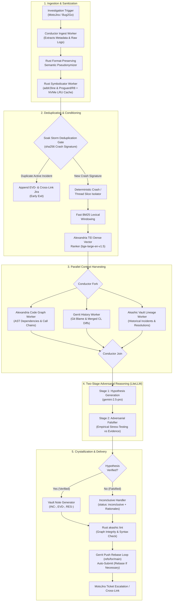
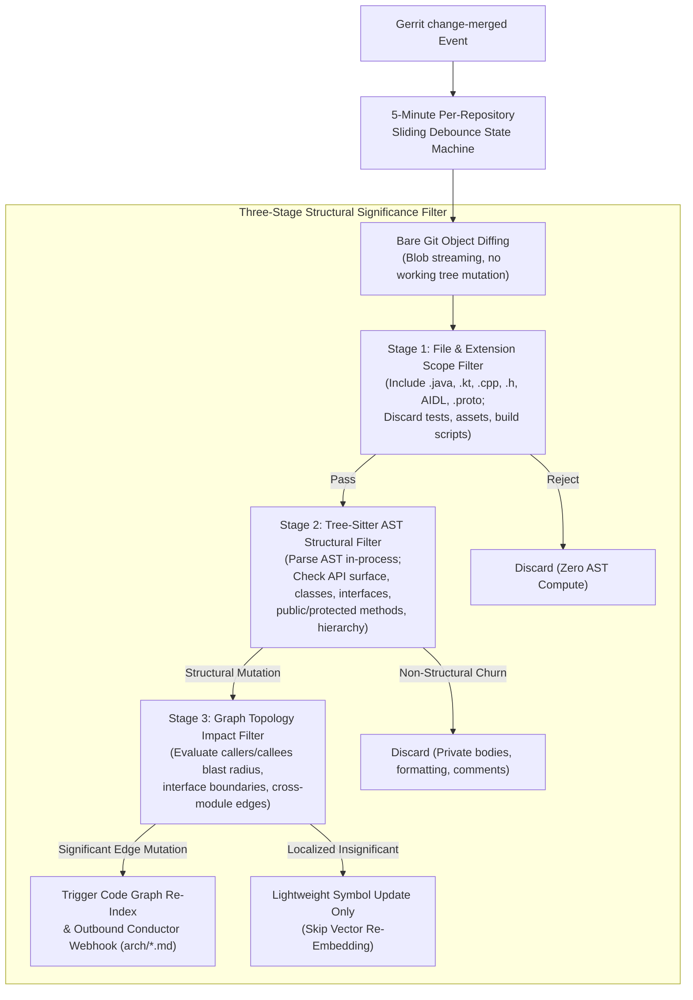
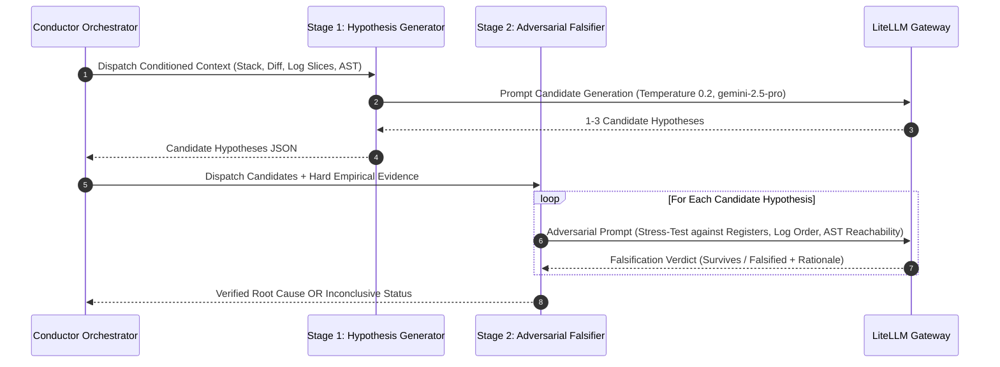

# Spec 0003: Consolidated Knowledge Infrastructure and Root Cause Analysis Architecture

## Problem Statement

Mean Time to Detect (MTTD) and Mean Time to Resolve (MTTR) for Motorola OEM Android soak crashes and diagnostic packages present an escalating bottleneck across device development and release lifecycles. Soak test fleets—consisting of hundreds of automated regression test benches and field test devices executing continuous sweeps—generate hundreds of complex Bug2Go diagnostic archives weekly. Triaging and remediating these failures is severely constrained by six fundamental architectural challenges:

1. **High MTTD/MTTR for OEM Android Soak Crashes and Bug2Go Packages**: Bug2Go packages are multi-gigabyte diagnostic archives bundling heterogenous crash dumps, kernel panics, system logs, ANR watchdog traces, tombstone dumps, and event logcat streams. Triage engineers spend hours manually unpacking, isolating the relevant thread slice, and correlating disparate log messages across megabytes of noisy background events.
2. **Multi-Repository Scale**: OEM Android architectures span dozens of distinct Git repositories, including OEM device trees, vendor Hardware Abstraction Layers (HALs), kernel adaptations, Android framework extensions, and proprietary OEM system applications. Tracing execution flow and blast radius across these boundaries manually is labor-intensive and prone to boundary misses.
3. **Unstripped Symbols and Proguard/R8 Obfuscation**: Native crash dumps manifest with raw hexadecimal program counter addresses, requiring matching unstripped ELF shared libraries (`.so`) from OEM build symbol servers. JVM runtime exceptions are heavily obfuscated by Proguard/R8, requiring build-fingerprint-synchronized `mapping.txt` files to reconstruct canonical class, method, and source line references.
4. **Spurious LLM Correlations and Hallucination**: Monolithic, single-pass LLM prompts produce spurious causal correlations when analyzing commit histories, frequently blaming innocent Gerrit changes simply because they touched adjacent source lines or merged within the same nightly build cycle. Without empirical falsification, these hallucinations waste engineering hours on false leads.
5. **Loss of Negative Knowledge**: When fix attempts fail in soak testing, workarounds are abandoned, or commits are reverted, the causal context of *why* the attempt failed is lost or discarded in closed Jira comments. Future engineers and autonomous AI coding agents inevitably repeat identical flawed remediation strategies because negative knowledge is not captured as an authoritative graph entity.
6. **Drift Between Code Reality and Architecture Documentation**: Static architectural documentation and subsystem specifications quickly rot under the pressure of continuous Gerrit merge velocity. Manual documentation updates cannot keep pace with dozens of daily commits, causing architectural documentation to diverge from the actual Abstract Syntax Tree (AST) reality of the codebase.

---

## Solution

This specification defines a consolidated end-to-end Knowledge Infrastructure and Root Cause Analysis (RCA) platform. The system unifies a dedicated version-controlled **Akashic Vault**, the **Alexandria** continuous code graph daemon, durable **Netflix/Orkes Conductor** workflow orchestration, **Two-Stage Adversarial Reasoning** via a pure **LiteLLM** abstraction gateway, **Hybrid Diagnostic Log Conditioning**, native **Format-Preserving Semantic Pseudonymization**, and **First-Class Resolution Tracking** capturing both positive and negative causal knowledge.



The consolidated solution provides:
- **Durable Orchestration**: A self-hosted Netflix/Orkes Conductor cluster orchestrating deterministic task execution, timeouts, retries, and auditability.
- **Polyglot Performance**: Compute-heavy symbolication, AST parsing, PII sanitization, and graph linting execute in native Rust; distributed orchestration, external integrations, and AI gateway interactions execute in Python.
- **Continuous Code Graph Intelligence**: The Alexandria daemon monitors Gerrit merge streams, computes bare Git AST diffs via tree-sitter, filters non-structural churn through a Three-Stage Structural Significance Filter, and debounces indexing on a 5-minute per-repo window.
- **Hybrid Diagnostic Log Conditioning**: High-density logs are condensed using deterministic crash/thread slicing, fast BM25 lexical windowing, and dense vector ranking via local Text Embeddings Inference (TEI) sidecars running `bge-large-en-v1.5`.
- **Zero-Pollution Data Privacy**: In-line format-preserving semantic pseudonymization scrubs sensitive user tokens while substituting typed placeholders (e.g., `<PHONE:US_VALID_10DIGIT>`) to preserve syntactic crash semantics.
- **Adversarial Causal Rigor**: Decoupled two-stage LLM reasoning eliminates hallucination by generating candidate hypotheses and systematically subjecting each to adversarial falsification against empirical logs, CPU registers, and AST reachability.
- **Negative Knowledge Preservation**: First-class Resolution nodes capture abandoned workarounds, invalid fix attempts, and multi-repo commit lineages via `abandoned_reason` and forward `supersedes` relations.
- **Automated Delivery**: Validated findings crystallize into canonical Akashic Markdown nodes, pass `akashic lint` (exit code 0), rebase cleanly against the Vault repository, auto-submit to Gerrit (`refs/for/main`), and update MotoJira tickets with bidirectional links.

---

## User Stories

1. As an OEM Android Developer, I want symbolicated stack traces and correlated code diffs delivered directly to MotoJira tickets, so that I can immediately inspect the exact line of failure without manually unpacking multi-gigabyte Bug2Go archives.
2. As an OEM Android Developer, I want to view verified negative knowledge and previously abandoned fix attempts for an incident, so that I do not waste time implementing workarounds that were already proven invalid or caused regressions.
3. As an OEM Android Developer, I want merged Gerrit changes to be structurally analyzed by Alexandria without altering my local git checkout or IDE state, so that background code graph updates never cause branch locks or interfere with active debugging.
4. As an OEM Android Developer, I want proposed RCA crystallization notes submitted as Gerrit changes against `refs/for/main`, so that I can review, discuss, and audit knowledge base additions using standard code review workflows.
5. As a Triage Engineer, I want the system to deterministically isolate the crash and thread slice from Bug2Go diagnostic archives, so that log volume is reduced by orders of magnitude before downstream LLM processing.
6. As a Triage Engineer, I want the RCA pipeline to automatically deobfuscate R8/Proguard application stack traces and symbolicate native tombstone hex frames, so that crash locations are immediately readable in terms of source files and line numbers.
7. As a Triage Engineer, I want inconclusive crash investigations to be explicitly flagged with falsification rationales and escalated in Jira, so that engineers are alerted when empirical evidence contradicts all candidate hypotheses.
8. As a Triage Engineer, I want historical incident and resolution nodes to be queryable by crash signature and component lineage, so that recurring soak regressions are instantly linked to their historical root causes.
9. As a Platform Infrastructure Operator, I want the RCA orchestration to run on a self-hosted Netflix/Orkes Conductor cluster backed by PostgreSQL and Redis on internal Kubernetes, so that multi-step investigation workflows are resilient to worker crashes, network interruptions, and transient infrastructure failures.
10. As a Platform Infrastructure Operator, I want high-throughput CPU-intensive parsing and linting tasks partitioned to native Rust workers while orchestration and LLM integrations run on Python, so that the platform maximizes resource efficiency and eliminates interpreter bottlenecks.
11. As a Platform Infrastructure Operator, I want code graph indexing to apply a per-repository 5-minute debounce window, so that bursty Gerrit merge spikes do not trigger redundant embedding passes or thrash compute resources.
12. As a Platform Infrastructure Operator, I want the system to leverage a unified LiteLLM gateway routing to local OmniRoute in development and Google Cloud Vertex AI in production, so that model endpoints can be swapped and load-balanced without rewriting investigation logic.
13. As a Security and Compliance Officer, I want all diagnostic logs and crash reports to undergo format-preserving semantic pseudonymization in Rust prior to LLM processing, so that sensitive user PII is replaced with typed semantic placeholders without breaking parse grammar or masking anomaly patterns.
14. As a Security and Compliance Officer, I want source code snippets to be scrubbed of OEM proprietary signing keys, credentials, and authentication tokens before vector embedding, so that confidential platform secrets never leak into external or shared vector stores.
15. As a Security and Compliance Officer, I want knowledge base updates to be governed by strict Gerrit access controls and automated `akashic lint` validation, so that unauthorized or malformed data cannot corrupt the authoritative vault.
16. As an Autonomous AI Coding Agent, I want to query Alexandria's code graph via Model Context Protocol (MCP) for upstream callers and downstream callees, so that I can determine the exact blast radius of a faulting symbol without performing expensive full-tree text searches.
17. As an Autonomous AI Coding Agent, I want to inspect first-class Resolution nodes with structured `abandoned_reason` and forward `supersedes` relations, so that my remediation planning avoids repeating flawed approaches and accounts for multi-repo fix dependencies.
18. As an Autonomous AI Coding Agent, I want hybrid log retrieval combining BM25 lexical windowing and dense BGE-large vector ranking, so that I receive precisely targeted log excerpts containing both keyword matches and semantically related diagnostic anomalies.
19. As an Autonomous AI Coding Agent, I want two-stage adversarial verification separating hypothesis generation from empirical falsification, so that candidate root causes that contradict register states or log timelines are discarded before generating fixes.
20. As a Release Manager, I want real-time visibility into soak crash root causes and blast radii across release branches, so that I can make informed go/no-go release decisions based on verified defect severity rather than raw ticket counts.
21. As a Release Manager, I want automated resolution tracking that maps fixes spanning multiple Gerrit repositories to their parent incident, so that coordinated cross-repo bug fixes are tracked and verified atomically prior to soak sign-off.
22. As a Release Manager, I want architecture documentation (`arch/<subsystem>.md`) to automatically reflect structurally significant API and hierarchy changes, so that architectural documentation never drifts from shipped OEM firmware reality.

---

## Implementation Decisions

### 1. Dedicated Akashic Vault Git Repository Partitioning
The system enforces ADR 0001 by storing knowledge graph nodes in a dedicated version-controlled Git repository rather than inside application source trees or external ticket trackers.
- **Partitioning Model**: Vault storage is partitioned strictly by application or subsystem namespace: `akashic/<app_id>/` (e.g., `akashic/com.motorola.camera3/`, `akashic/com.motorola.systemui/`, `akashic/vendor.qcom.hardware.camera/`).
- **Isolation Guarantee**: Prevents Git lock contention, CI checkout overhead, and index thrashing in production source code repositories.
- **Authoritative System of Record**: Code repositories and MotoJira remain primary systems of record for source code and operational ticketing; the Vault serves as the authoritative, versioned graph of verified causal analysis, architectural invariants, and negative knowledge.

### 2. Node Taxonomy & Prototype YAML Schemas

The Akashic Vault implements the Google Open Knowledge Format (OKF) v0.2 specification with first-class domain extensions (`type: Resolution` and `type: Architecture`). Under OKF v0.2, all knowledge nodes are represented as versioned Markdown documents with strict YAML frontmatter validated by `akashic lint`.

#### Google OKF v0.2 Schema Alignment & Extension Mechanism
- **Native OKF v0.2 Foundation**: OKF v0.2 provides foundational schemas for `Incident` and `Evidence` nodes.
- **First-Class Domain Extensions**: `type: Resolution` (documenting verified fixes, abandoned workarounds, and negative knowledge) and `type: Architecture` (documenting structural subsystem boundaries, AST interfaces, and invariants) are native, first-class extensions within the OEM Motorola OKF schema namespace (`oem.motorola.okf/v0.2`).
- **Forward-Only Relations Rule**: All graph edges adhere strictly to forward-only navigation semantics to preserve node immutability in Git history and prevent multi-worker write locks:
  * **Supersession**: Successor nodes declare `supersedes: <older_node>`, pointing backward in the investigation timeline from the new active node. Older superseded nodes are never retroactively modified to inject an inverse `superseded_by` field.
  * **Resolution**: Resolution nodes declare `resolves: <incident_node>` pointing to the target Incident node. Incident nodes remain immutable and are never modified with an inverse `resolved_by` property.
- **Deterministic Node Identifiers**: Node filenames and YAML identifiers strictly follow deterministic naming conventions:
  * **Incidents**: `INC-<JIRA_KEY>.md` (e.g., `INC-MOTOCAM-9102.md`)
  * **Evidence**: `EVD-<JIRA_KEY>-<SRC>.md` (e.g., `EVD-MOTOCAM-9102-STACK.md`, `EVD-MOTOCAM-9102-BUG2GO.md`)
  * **Resolutions**: `RES-<JIRA_KEY>-<SEQ>.md` (e.g., `RES-MOTOCAM-9102-01.md`, `RES-MOTOCAM-9102-02.md`)
  * **Architecture**: `arch/<subsystem>.md` (e.g., `arch/camera-client-lifecycle.md`)
- **Standardized Date Format**: All temporal fields enforce standard ISO `YYYY-MM-DD` strings (`valid_from: YYYY-MM-DD`, `last_structural_sync: YYYY-MM-DD`).
- **Vault Graph Relations vs External References**: `relations:` is strictly reserved for inter-note graph edges whose `target:` resolves to another Markdown note within the vault (`./<relative-path>.md`). External code repositories, source file paths, and Gerrit CLs must NOT be placed in `relations:` — they belong under `external_refs:` (or `gerrit_cls:`) or within the Markdown body.

The taxonomy comprises four core node types:

#### Incident Node (`INC-`)
Authoritative node representing a concrete failure event observed during soak regression or production testing. Under the forward-only rule, `Incident` nodes never declare `resolved_by`.

```yaml
---
id: INC-MOTOCAM-9102
title: "SIGSEGV in CameraDeviceClient::notifyError during buffer release"
type: Incident
status: resolved # active | resolved | inconclusive | superseded
valid_from: 2026-10-09
crash_signature: "7f8a9b0c1d2e3f4a5b6c7d8e9f0a1b2c3d4e5f6a7b8c9d0e1f2a3b4c5d6e7f8a"
scope:
  app: com.motorola.camera3
  system: camera-framework
  device: falcon
  build_fingerprint: "motorola/falcon/falcon:14/U1UD34.22-12/261008:user/release-keys"
  android_version: "14"
external_refs:
  jira_key: MOTOCAM-9102
  bug2go_id: B2G-882194
relations:
  - type: supported_by
    target: ../evidence/EVD-MOTOCAM-9102-STACK.md
  - type: caused_by
    target: ../architecture/arch-camera-client.md
---

# Incident: MOTOCAM-9102 SIGSEGV Crash

## Summary
Fatal SIGSEGV null pointer dereference observed during burst capture soak testing on falcon build U1UD34.22-12.
```

#### Evidence Node (`EVD-`)
Immutable empirical artifact substantiating or falsifying a causal claim.

```yaml
---
id: EVD-MOTOCAM-9102-STACK
title: "Symbolicated Crash Dump and Register State for MOTOCAM-9102"
type: Evidence
status: active
valid_from: 2026-10-09
scope:
  app: com.motorola.camera3
  system: camera-framework
  device: falcon
  android_version: "14"
external_refs:
  jira_key: MOTOCAM-9102
  bug2go_id: B2G-882194
relations:
  - type: substantiates
    target: ../incidents/INC-MOTOCAM-9102.md
---

# Evidence: MOTOCAM-9102 Symbolicated Tombstone

## Faulting Frame
```text
#00 0x00042f10 in android::CameraDeviceClient::notifyError at CameraDeviceClient.cpp:412
    fault addr 0x00000000 (null dereference on mResultExtras)
#01 0x00038b24 in android::CameraDeviceClient::onCaptureErrorLocked at CameraDeviceClient.cpp:528
```
```

#### First-Class Resolution Node (`RES-`) & Negative Knowledge
Captures remediation actions, preserving negative knowledge (`abandoned_reason`), workarounds, and multi-repository fix commits. Successor resolutions declare forward `supersedes` relations; older nodes are never retroactively modified.

```yaml
---
id: RES-MOTOCAM-9102-02
title: "Revert CL 489201 and Restore Defensive Null Check in CameraDeviceClient"
type: Resolution
status: active # active | abandoned | superseded
remediation_type: revert # workaround | hotfix | permanent_fix | revert
abandoned_reason: null
valid_from: 2026-10-10
scope:
  app: com.motorola.camera3
  system: camera-framework
external_refs:
  jira_key: MOTOCAM-9102
  gerrit_cls:
    - repo: motorola/platform/frameworks/av
      change_id: I7c88e89f029a1b1c3e4e9b891102938472910382
      cl_number: 490102
relations:
  - type: resolves
    target: ../incidents/INC-MOTOCAM-9102.md
  - type: supersedes
    target: ../resolutions/RES-MOTOCAM-9102-01.md
  - type: supported_by
    target: ../evidence/EVD-MOTOCAM-9102-STACK.md
---

# Resolution: Revert CL 489201
Restored defensive pointer validation to prevent null dereferences during asynchronous error teardown.
```

**Negative Knowledge Representation (Abandoned Resolution Example)**:
When an initial workaround fails in regression testing, it is preserved in the Vault with status `abandoned`, ensuring autonomous agents and engineers do not repeat the failure. In adherence with the Forward-Only Relations Rule, it does not include an inverse `superseded_by` pointer.

```yaml
---
id: RES-MOTOCAM-9102-01
title: "Catch NullPointerException in CameraManager Callback"
type: Resolution
status: abandoned
remediation_type: workaround
abandoned_reason: "Catching the null exception at the Java callback layer masked the internal HAL state desynchronization, resulting in silent camera preview freeze and downstream watchdog timeout (ANR) during camera sensor switching."
valid_from: 2026-10-09
scope:
  app: com.motorola.camera3
  system: camera-framework
external_refs:
  jira_key: MOTOCAM-9102
  gerrit_cls:
    - repo: motorola/packages/apps/MotoCamera3
      change_id: I2a3b4c5d6e7f8a9b0c1d2e3f4a5b6c7d8e9f0a1b
      cl_number: 489950
relations:
  - type: resolves
    target: ../incidents/INC-MOTOCAM-9102.md
---

# Abandoned Resolution: Callback Layer Exception Masking
Documents negative knowledge regarding why exception suppression at the application layer was rejected.
```

#### Subsystem Architecture Node (`arch/<subsystem>.md`)
Maintains live architectural invariants and structural module boundaries continuously reconciled by Alexandria.

```yaml
---
id: ARCH-camera-client-lifecycle
title: "Camera Device Client Session & Buffer Lifecycle"
type: Architecture
status: active
subsystem: camera-framework
app_scope: com.motorola.camera3
last_structural_sync: 2026-10-14
external_refs:
  repo: motorola/platform/frameworks/av
  source_file: services/camera/libcameraservice/api2/CameraDeviceClient.cpp
relations:
  - type: referenced_by
    target: ../incidents/INC-MOTOCAM-9102.md
---

# Architecture: Camera Device Client Lifecycle
Defines lifecycle guarantees, state transitions, and asynchronous error propagation invariants.
```

---

### 3. Alexandria Code Graph & Three-Stage Structural Significance Filter
Alexandria runs as a continuous native Rust daemon monitoring Gerrit merge events over an SSH stream (`gerrit stream-events`). To ensure that the graph accurately reflects codebase structural reality without thrashing resources or depending on commit message discipline, Alexandria implements a **Three-Stage Structural Significance Filter**, a 5-minute debounce window, and strict project filtering.

#### Gerrit Stream-Events Project Filtering & Loop Prevention
Alexandria's ingest loop subscribes to Gerrit `change-merged` events and immediately evaluates the target Git project name. To prevent infinite self-trigger loops, the daemon drops any event where `project` matches `akashic/*` or `akashic-*`. Commits made by the RCA pipeline's automated crystallization or architectural reconciliation workers to the Akashic Vault are thus strictly ignored by Alexandria's ingestion listener.

#### Language Grammar Roadmap
To support the full depth of Motorola OEM Android platform components across JVM and native layers, Alexandria implements a phased grammar roadmap:
- **Phase 1 (Production JVM)**: In-process AST parsing and diffing for Java and Kotlin using `tree-sitter-java` and `tree-sitter-kotlin` (integrated via `q-gate` bindings). Resolves classes, interfaces, inheritance hierarchies, and method signatures in sub-second time.
- **Phase 2 (Native HAL & Daemons Roadmap)**: Integrates native C/C++ (`tree-sitter-cpp`) and AIDL/Protobuf (`tree-sitter-aidl`, `tree-sitter-protobuf`) grammars. This enables incremental structural graph indexing across vendor Hardware Abstraction Layers (HALs), native camera/audio system daemons, and IPC binder interface boundaries.

#### Three-Stage Structural Significance Filter Architecture



1. **Stage 1: File & Extension Scope Filter**:
   - Inspects file paths modified in the commit diff.
   - Retains source files: `.java`, `.kt`, `.cpp`, `.cc`, `.h`, `.aidl`, `.proto`.
   - Discards non-architectural assets: test fixtures (`*Test.java`), build configurations (`build.gradle`, `Android.bp`, `Makefiles`), assets, documentation, and formatting configs.
2. **Stage 2: Tree-Sitter AST Structural Filter**:
   - Parses modified source files in-process using tree-sitter grammars (via `q-gate`).
   - Compares the AST symbol table between the pre-commit and post-commit Git blobs.
   - Identifies structural changes:
     * Additions, deletions, or renames of classes, interfaces, traits, or enums.
     * Modifications to class inheritance hierarchies (`extends`, `implements`).
     * Signature alterations on `public` and `protected` methods, constructors, and exposed fields.
   - Filters out non-structural churn: modifications strictly contained within private method bodies, local variable renames, code formatting changes, and comment updates.
3. **Stage 3: Graph Topology & Blast Radius Impact Filter**:
   - Evaluates the topological impact of identified AST modifications against the embedded SQLite graph.
   - Computes affected caller/callee blast radius. If structural modifications introduce new cross-module dependencies, break existing call edges, or alter public API boundaries, the commit is classified as **Structurally Significant**.
   - Structurally significant changes trigger vector re-embedding via the local TEI sidecar and trigger architectural documentation reconciliation (`arch/<subsystem>.md`).
4. **Debounce State Machine & Outbound Architectural Webhook**:
   - Applies a 5-minute per-repository sliding debounce state machine: `Idle` ➔ `Accumulating` ➔ `Diffing` ➔ `Notifying`. Burst merges accumulate and process as a single consolidated AST differential pass, preventing redundant TEI embedding computation.
   - When structural API mutations are confirmed, Alexandria's outbound HTTP client fires a webhook to Netflix/Orkes Conductor (`POST /api/workflow/akashic_arch_reconciliation_pipeline`), dispatching repository metadata, modified AST symbols, and git range to trigger the `arch_reconciliation_worker` to reconcile `arch/<subsystem>.md` documentation.
   - Operates completely independent of commit message discipline: conventional commit prefixes, Gerrit tags, or developer commit descriptions never bypass or dictate the filter.

---

### 4. Polyglot Worker Split & Local Caching
The runtime architecture strictly enforces ADR 0002 by separating compute and parsing tasks from distributed workflow orchestration and AI reasoning:

| Runtime | Specialized Responsibilities | Key Components & Workers |
| :--- | :--- | :--- |
| **Native Rust** | Memory-heavy parsing, deterministic symbolication, binary diffing, format-preserving pseudonymization, fast BM25 log scoring, and graph linting. | `android_symbolicator_worker` (addr2line, R8 deobfuscator, local NVMe Symbol Store LRU cache), `format_preserving_sanitizer`, `bm25_log_window_scorer`, `akashic_crystallize_worker` (`akashic lint`), `alexandria-daemon` (Tokio async daemon, tree-sitter AST diffing). |
| **Python 3.11+** | Conductor worker polling, REST/SSH API integration, LiteLLM gateway routing, dense vector ranking coordination, and multi-agent reasoning. | `jira_bug2go_ingest_worker`, `crash_signature_dedup_worker`, `hybrid_log_conditioning_worker` (TEI sidecar orchestration), `alexandria_code_graph_worker` (MCP client), `gerrit_history_worker`, `akashic_lineage_worker`, `rca_hypothesis_worker`, `rca_falsifier_worker`, `delivery_notification_worker`. |

#### Symbol Store Local NVMe LRU Cache
To eliminate repetitive multi-gigabyte artifact downloads across continuous soak testing runs, the native Rust `android_symbolicator_worker` maintains a local high-speed NVMe-backed LRU cache (`/mnt/nvme/symbols`):
- **Keyed by Build Fingerprint**: Indexed by Android OS `ro.build.fingerprint` extracted from the crash header.
- **Cached Artifacts**: Stores unstripped native shared libraries (`.so`) with debug symbols and Proguard/R8 `mapping.txt` obfuscation maps.
- **Zero-Latency Symbolication**: On cache hit, symbolication and deobfuscation execute in sub-second time without contacting remote OEM build artifact repositories or S3 buckets. Cache misses pull artifacts asynchronously, update the LRU table, and evict least-recently used builds when the disk threshold (500 GB) is reached.

---

### 5. Soak Storm Deduplication Gate
Continuous soak test sweeps across hundreds of automated test benches frequently trigger identical crashes across multiple devices simultaneously during regression storms. To prevent resource exhaustion and redundant reasoning:
- **Deterministic Crash Signature**: Evaluated immediately after symbolication:
  $$\text{Crash Signature} = \text{sha256}(\text{app\_id} + \text{exception\_or\_signal} + \text{top\_3\_symbolicated\_app\_frames})$$
- **Deduplication Check**: The `crash_signature_dedup_worker` queries the target application Vault (`akashic/<app_id>`) for an active `Incident` sharing the exact `crash_signature`.
- **Early Exit Path**:
  * If an active `Incident` exists, downstream harvesting and LLM reasoning are bypassed.
  * The incoming Bug2Go diagnostic logs are formatted as a new Evidence node (`EVD-<JIRA_KEY>-BUG2GO.md`) and linked to the active `Incident`.
  * MotoJira is updated with a comment pointing to the existing Incident and active Gerrit CL.
  * The Conductor workflow sets `deduplicated: true` and terminates early with status `COMPLETED`.
  * If no matching active Incident exists, the workflow proceeds to hybrid log conditioning and parallel harvesting.

---

### 6. Hybrid Diagnostic Log Conditioning
Soak Bug2Go archives frequently exceed several gigabytes, containing hundreds of thousands of lines of noisy system events. To provide high-signal, hallucination-resistant context to LLM reasoning workers within tight token budgets, the system employs a three-tier hybrid log conditioning pipeline:

1. **Deterministic Crash/Thread Slicing**:
   - Extracts the fatal thread ID and process ID from the crash header.
   - Extracts the 500 lines preceding the crash event for the faulting thread.
   - Extracts synchronous logcat traces from all peer threads sharing the same process group or active IPC transaction binder.
2. **Fast BM25 Lexical Windowing**:
   - Executes the native Rust `bm25_log_window_scorer` over the full system logcat.
   - Queries for fault-specific tokens: exception class names, faulting symbol identifiers, Android fatal tags (`FATAL EXCEPTION`, `DEBUG`, `AndroidRuntime`), and hardware error codes.
   - Retains top-scoring contiguous log windows (50 lines per window).
3. **Alexandria TEI Dense Vector Ranking**:
   - Chunks candidate log excerpts into 256-token segments.
   - Generates dense vector embeddings via a local Text Embeddings Inference (TEI) sidecar running `bge-large-en-v1.5`.
   - Computes cosine similarity against the symbolicated crash signature and fault context.
   - Selects the top 5 most semantically relevant diagnostic windows, combining lexical precision with semantic anomaly detection.

---

### 7. Format-Preserving Semantic Pseudonymization
To comply with security and privacy requirements without compromising diagnostic syntax or anomaly detection, a native Rust engine performs **Format-Preserving Semantic Pseudonymization** in-line before logs or code snippets reach vector stores or LLM contexts:
- **Typed Semantic Placeholders**: Replaces PII with structured, typed tokens that preserve the original data's syntax, length category, and semantic type:
  * US Phone Number `(312) 555-0199` ➔ `<PHONE:US_VALID_10DIGIT>`
  * International Phone `+44 20 7946 0991` ➔ `<PHONE:INTL_E164>`
  * Email Address `j.doe@motorola.com` ➔ `<EMAIL:CORP_DOMAIN>`
  * Hardware IMEI `354892091234567` ➔ `<IMEI:VALID_15DIGIT>`
  * MAC Address `00:1A:2B:3C:4D:5E` ➔ `<MAC:VALID_HEX>`
  * GPS Coordinates `41.881832, -87.623177` ➔ `<GPS:COORD_PAIR>`
  * Device Serial Number `ZY3224L9PQ` ➔ `<DEV_SERIAL:OEM_ALPHANUM>`
- **Preservation of Diagnostic Semantics**: Unlike generic redaction (e.g., `[REDACTED]`), format-preserving tokens ensure that log parsing regexes, JSON log payload formats, and crash anomaly patterns remain completely valid for downstream reasoning.
- **OEM Credential & Secret Scrubbing**: Cryptographic private keys, OEM signing certificates, and Gerrit authentication tokens are replaced with canonical `<OEM_SECRET_SCRUBBED>` tokens.

---

### 8. Two-Stage Adversarial Reasoning via LiteLLM
To eliminate hallucinations and spurious correlations, reasoning is structured into two sequential, adversarial phases governed by ADR 0005:



1. **Stage 1: Hypothesis Generation (`rca_hypothesis_worker`)**:
   - Synthesizes the conditioned diagnostic context: symbolicated crash stack, Alexandria AST blast radius, merged Gerrit change diffs, and historical Vault lineage.
   - Formulates 1 to 3 candidate Hypotheses explaining the causal path from code change to runtime failure via `gemini-2.5-pro`.
2. **Stage 2: Adversarial Falsification (`rca_falsifier_worker`)**:
   - Acts as an adversarial critic with strict instructions to falsify each candidate Hypothesis.
   - Evaluates each candidate against hard empirical evidence:
     * Does the suspect commit modify code executed prior to the crash timestamp in logcat?
     * Does the faulting CPU register state match the hypothesized variable state?
     * Is the faulting symbol structurally reachable from the suspect commit's AST changes according to Alexandria?
   - A candidate is falsified if any empirical check fails. Only a Hypothesis that withstands falsification is promoted to verified Root Cause.

---

### 9. Inconclusive Crash Handling
When all candidate Hypotheses are falsified or the empirical evidence is insufficient to establish a definitive causal link:
- **Status Assignment**: The incident is assigned `status: inconclusive`.
- **Crystallization of Rationales**: An `INC-` node is crystallized recording the verified symptoms, conditioned log slices, and explicit rationales detailing why each candidate Hypothesis was falsified.
- **Jira Escalation**: MotoJira is updated with an `Inconclusive Investigation` triage status, listing identified diagnostic gaps (e.g., missing unstripped HAL binary, incomplete logcat buffer) and specific recommended manual verification steps.

---

### 10. Pure LiteLLM Abstraction & Unified Routing
All LLM reasoning tasks interact through a unified OpenAI-compatible LiteLLM proxy:
- **Development Environment**: Routes to local OmniRoute proxy (`http://localhost:20128/v1`), supporting local quantized models or mock responses for zero-cost developer testing.
- **Production Environment**: Routes through Google Cloud Vertex AI Application Default Credentials (ADC) to authoritative reasoning models (`gemini-2.5-pro` and Claude 3.5 Sonnet).
- **Configuration Decoupling**: Worker logic remains completely agnostic of backend provider, credentials, or model endpoints.

---

### 11. Self-Hosted Conductor Cluster on Internal Kubernetes
The workflow engine runs as a self-hosted Netflix/Orkes Conductor cluster on internal Kubernetes infrastructure:
- **Persistence Layer**: Backed by a high-availability PostgreSQL cluster for execution history, workflow definitions, and task metadata.
- **Queuing & Coordination**: Backed by a Redis cluster for distributed task queues, locks, and low-latency worker polling.
- **Durability**: Conductor persists task states after every step. If a worker pod fails, the task is automatically re-queued and executed from the last successful checkpoint without restarting the investigation.

---

### 12. Fully Automated Delivery & Gerrit Code Review Lifecycle
Crystallized knowledge nodes undergo automated verification, robust rebase handling, and delivery:
1. **Gerrit Push Rebase Loop**:
   - The `delivery_notification_worker` commits the newly formatted Markdown nodes (`INC-`, `EVD-`, `RES-`) to the local Git clone of the Vault.
   - The worker executes an automated rebase loop against Gerrit (`refs/for/main`):
     * If the remote repository has advanced due to concurrent worker submissions, the push is rejected.
     * The worker executes `git pull --rebase origin main`.
     * The worker re-runs `akashic lint` on the rebased tree to verify that concurrent additions did not introduce conflicting node IDs, broken relative links, or invalid frontmatter.
     * On clean lint, the worker retries the push to `refs/for/main` (up to 3 retry attempts).
2. **Gerrit Submit Type Configuration**:
   - The Akashic Vault project repository in Gerrit is configured with submit type `Rebase If Necessary`. This ensures that linear history is maintained without unnecessary merge commits while allowing clean fast-forward or cherry-pick merges.
3. **Automated Validation & Auto-Submit**:
   - Gerrit triggers the `akashic lint` validation hook. The linter enforces OKF v0.2 graph schema compliance, checks link validity, and validates YAML frontmatter.
   - If `akashic lint` exits with return code 0 and no orphaned edges or syntax errors exist, the automation bot automatically casts votes `Code-Review: +2` and `Verified: +1`, submitting the change directly to the Vault main branch.
4. **Self-Trigger Loop Prevention**:
   - When the change merges into `main`, Gerrit emits a `change-merged` event. Alexandria's event listener inspects the event's project name, drops events where `project` matches `akashic/*`, and ignores the commit, preventing an infinite re-index and reconciliation loop.
5. **MotoJira Synchronization**:
   - The pipeline posts a final triage comment to the originating MotoJira ticket, including the executive summary, verified root cause, Gerrit review link, and relative Vault node path.

---

## Testing Decisions

### Definition of Good Tests
Tests must verify externally observable system behavior across public integration boundaries rather than asserting on private internal implementation details. Tests must not inspect internal AST walker traversal states, private channel buffer sizes, or in-memory worker variables. Verification must occur at public interfaces: Conductor task execution inputs/outputs, Git commit objects, Gerrit push events, REST endpoints, and `akashic lint` process exit codes.

### Primary Seam: End-to-End Ingestion-to-Crystallization Seam
- **Boundary**: Dispatches a simulated Investigation Trigger with an obfuscated Bug2Go archive fixture and a target Gerrit change range to the Conductor workflow endpoint.
- **Verification Assertions**:
  1. The workflow completes with status `COMPLETED`.
  2. The generated Vault commit in Gerrit contains valid `INC-`, `EVD-`, and `RES-` Markdown nodes.
  3. `RES-` nodes correctly populate `remediation_type`, `gerrit_cls`, and relations (`resolves`, `supersedes`).
  4. Executing `akashic lint` across the resulting Vault tree passes with exit code 0.
  5. The mock MotoJira service receives an issue update with the symbolicated summary and link to the Gerrit CL.

### Secondary Seam: Structural Merge-to-Vault Architecture Seam
- **Boundary**: Dispatches synthetic Gerrit `change-merged` commit events to Alexandria's ingestion interface.
- **Verification Assertions**:
  1. A commit containing only private method body alterations or comment changes is filtered by Stage 2 of the Structural Significance Filter and produces zero modifications to `arch/<subsystem>.md`.
  2. A commit introducing a new public interface or modifying class inheritance passes the Three-Stage Structural Significance Filter, triggering an updated Code Graph projection and a synchronized `arch/<subsystem>.md` changeset in the Vault.
  3. A rapid burst of commits merged within 5 minutes triggers exactly one consolidated indexing pass following the debounce window.

### Modules Tested and Prior Art
- **Native Rust Binaries**: `android_symbolicator_worker`, `akashic_crystallize_worker`, format-preserving sanitizer, and Alexandria AST engine.
- **Python Workers**: Conductor task handlers, BM25 retriever, LiteLLM gateway client.
- **Prior Art**: Testing fixtures and AST validation harness leverage patterns established in the `q-gate` native test suite and Netflix Conductor workflow verification frameworks.

---

## Out of Scope

- **Autonomous Code Patching**: The platform will not autonomously commit or push production source code fixes to Android application repositories without human developer review and verification.
- **Local Working Tree Mutation**: Alexandria and Conductor workers will never mutate local developer git checkouts, switch branches, or acquire file locks in active developer workspaces.
- **Direct Hardware Flashing**: Physical bench control, device flashing, battery test harness manipulation, and JTAG hardware-in-the-loop debugging are handled by external soak infrastructure and remain out of scope.
- **Bidirectional Third-Party Wiki Synchronization**: The system will not maintain continuous bidirectional state synchronization with proprietary enterprise wikis (Confluence, Notion); the Akashic Vault Git repository remains the sole authoritative source of truth.
- **Public Cloud LLM Direct Calls**: Workers will not bypass the internal LiteLLM gateway to call unauthenticated third-party public cloud AI APIs.
- **Legacy Non-JVM Build System Re-architecting**: Refactoring legacy C/C++ Make/Ninja build environments outside of ELF symbolication and bare git diffing is out of scope.

---

## Further Notes

- **ADR Alignment**:
  * [ADR 0001: Dedicated Vault Repository and On-Demand Crystallization](file:///home/pedrogoncalves/projects/knowledge-base/docs/adr/0001-dedicated-vault-repository-and-on-demand-crystallization.md)
  * [ADR 0002: Polyglot Worker Runtime Split](file:///home/pedrogoncalves/projects/knowledge-base/docs/adr/0002-polyglot-worker-runtime-split.md)
  * [ADR 0003: Gerrit Event-Driven Synchronization and Non-Destructive Supersession](file:///home/pedrogoncalves/projects/knowledge-base/docs/adr/0003-gerrit-event-driven-synchronization-and-supersession.md)
  * [ADR 0004: Standalone Alexandria Code Graph Engine Integration](file:///home/pedrogoncalves/projects/knowledge-base/docs/adr/0004-alexandria-rust-incremental-code-graph.md)
  * [ADR 0005: Conductor RCA Orchestration and Two-Stage Reasoning](file:///home/pedrogoncalves/projects/knowledge-base/docs/adr/0005-conductor-rca-orchestration-and-two-stage-reasoning.md)
- **Domain Language Alignment**: Fully aligned with the ubiquitous language codified in [CONTEXT.md](file:///home/pedrogoncalves/projects/knowledge-base/CONTEXT.md), including `Resolution Node`, `Remediation Type`, `Negative Knowledge`, `Format-Preserving Semantic Pseudonymization`, `Structural Significance Filter`, `Crash Signature`, `Soak Storm Deduplication Gate`, and `Symbol Store LRU Cache`.
